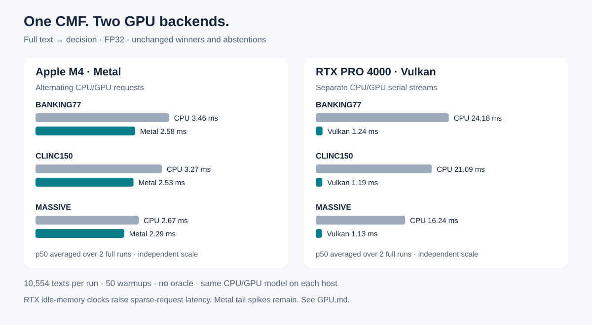

Русский: [README.ru.md](README.ru.md) · 中文: [README.zh.md](README.zh.md)

# CMF — Cortiq Model Format

CMF is an auditable model container: one file can hold weights, tokenizer,
chat metadata, task masks and skill overlays for inference without a large
framework runtime.

[](https://github.com/infosave2007/cmf/actions/workflows/ci.yml)
[](https://crates.io/crates/cortiq-core)
[](https://docs.rs/cortiq-core)
[](LICENSE)

## CMF against other formats

The table scores the file format and its reference runtime out of 100. Each
criterion gets 0–100 and a weight. The weights are ours and printed, so you can
recompute the totals for your own needs. Ecosystem size (how many models are
already published, how many third-party tools exist) is not a property of the
file, so it is not scored.

| criterion | weight | CMF | GGUF | safetensors | ONNX | MLX | EXL3 | PyTorch `.pt` |
|---|---:|---:|---:|---:|---:|---:|---:|---:|
| **Quantization range**: encodings the format itself defines, from 16 bits to below 1 bit | 15 | **100** | 90 | 30 | 50 | 60 | 70 | 25 |
| **Mixed codecs in one file**: any codec on any tensor, re-quantization in place | 10 | **100** | 90 | 50 | 60 | 70 | 75 | 30 |
| **Empty weights take no space**: pruned neurons and experts are not stored, every layer keeps its own width | 15 | **100** | 45 | 30 | 60 | 25 | 25 | 30 |
| **Flexibility, many tasks on one base**: task masks, skills and expert routing inside one file | 15 | **100** | 40 | 35 | 20 | 30 | 20 | 35 |
| **Self-contained file**: tokenizer, chat template, multi-component pipelines | 10 | **100** | 80 | 30 | 45 | 30 | 25 | 25 |
| **Integrity and authenticity**: content hashes, verification, signature | 10 | **100** | 30 | 55 | 35 | 50 | 50 | 10 |
| **Zero-copy, lazy loading**: mmap, the GPU reads the mapped file, experts on demand | 10 | **100** | 90 | 85 | 40 | 80 | 60 | 40 |
| **Safe evolution**: an old reader refuses what it cannot run | 5 | **100** | 70 | 60 | 85 | 50 | 40 | 40 |
| **Standalone runtime**: no Python or ML framework, CPU and GPU | 10 | 90 | **100** | 30 | 70 | 50 | 15 | 0 |
| **Weighted total** | **100** | **99** | 69 | 42 | 49 | 48 | 42 | 26 |

The evidence behind the CMF column:

- **17 weight encodings in one directory.**
  - Float: f32, f16, bf16.
  - 8-bit: `q8_row`, and `q8_2f` with row and column scales.
  - 4-bit: `q4_block`, `q4t`, `q4tp` (predicted scales, 4.17 bits/weight), and `mxfp4` (re-packs OCP MXFP4 checkpoints without loss).
  - Variable 3–8 bits: `vbit` and `vbit_ro`.
  - 2-bit: `q2tp`.
  - Ternary: `q1t`.
  - Binary: `q1`, `q1g` (1.125 bits/weight), and `q1s` (binary plus outliers).
  - Below 1 bit/weight: binary low-rank `blr`.
- **Any encoding on any tensor.** Every directory entry carries its own dtype.
  `--tensor-quant PATTERN=CODEC` picks codecs at conversion. `cortiq requant`
  changes them in an existing file without going back to the source checkpoint.
- **Empty weights take no space.** A pruned FFN neuron or MoE expert is neither
  stored nor computed. Each layer keeps its own width and its own expert count,
  because the reader takes sizes from tensor shapes, not from one global number
  ([spec §11](docs/CMF_V2_SPEC.md)). Experts and skills the current task does
  not use are never read from disk.
- **Many tasks on one base.**
  - A task mask costs 1 bit per FFN neuron, attention head, layer and expert.
  - Skills are replacement tensors in the same file and take memory only when used.
  - A skill can also ship as a separate small file, bound to its base by hash.
- **One file, pipelines included.** The tokenizer and chat template are stored
  in the file. Image-editing models (transformer, text encoder, VAE and
  scheduler), video models and speech models are single files too.
- **Integrity.** Every tensor and every section has a hash. `cortiq verify`
  checks the whole chain, and an optional Ed25519 signature comes from
  `cortiq sign`. A damaged file refuses to open instead of producing garbage.
- **Loading.**
  - Weights are page-aligned and tensors 64-byte aligned, and the file is memory-mapped.
  - On Apple silicon the GPU reads tensors straight from the mapping, with no copy.
  - MoE experts are paged in when the router picks them.
- **Safe evolution.** Every new capability gets a required-feature bit. A reader
  that does not know a bit refuses the file instead of guessing.
- **Runtime.** Written in Rust with no Python, it runs on CPU, Metal and
  Vulkan/DX12. A separate Python reader (stdlib + numpy) is also provided.
  `cortiq import-gguf` converts GGUF files directly. CMF scores 90 rather than
  100 in the last row because llama.cpp also has CUDA, ROCm and SYCL back ends.

The criteria, and the reasoning behind every other format's score, are in
[docs/COMPARISON.md](docs/COMPARISON.md).

## Decisions on Metal and Vulkan

**Cortiq 0.8.0:** one CMF file with trainable skills, local decisions by
reconstruction error — no token generation. CPU by default; select a GPU with
`CORTIQ_DECISION_DEVICE=metal` or `vulkan`. The standard crates.io installation
includes GPU support (Rust 1.88+).



[Quick start, custom skills and API](docs/decision/hf/README.md) ·
[Measurements and limits](docs/decision/hf/GPU.md)

## Status

CMF v2 is the current on-disk format. Readers validate the envelope, section
bounds, tensor metadata and hashes; incompatible changes require a feature bit
or version bump. The Rust crate APIs are still pre-1.0 and may change.

The project is usable for local inference and format experiments. Treat model
quality and speed numbers as workload-specific measurements, not guarantees;
see the focused guides for the test setup behind each claim.

## Quick start

Install the CLI and convert a small public checkpoint:

```sh
cargo install cortiq-cli --locked
cortiq convert --model Qwen/Qwen3-0.6B --quant q8 --output qwen.cmf
cortiq run qwen.cmf --prompt "What is the capital of France?" --greedy --no-think
```

Already have GGUF? Import it directly:

```sh
cortiq import-gguf model.gguf --output model.cmf
cortiq verify model.cmf
```

## Apex-35B-V1.0 and faster Qwen3.5-MoE graphs (0.8.48)

[Apex-35B-V1.0](https://huggingface.co/infosave/Apex-35B-V1.0-cmf), an agentic
fine-tune of Qwen3.6-35B-A3B with tool calling and dynamic thinking:

```sh
hf download infosave/Apex-35B-V1.0-cmf apex-35b-v1.0-q4tp-v2.cmf --local-dir .
cortiq run apex-35b-v1.0-q4tp-v2.cmf --prompt "Write a Python function that merges two sorted lists." --max-tokens 4096
```

On an NVIDIA A40 the 4-bit file decodes at 80 tok/s and reads a 4096-token
prompt at ~390 tok/s (first token in 10.5 s). The same release speeds up every
Qwen3.5/3.6-MoE stack on Vulkan: the prompt of a q4tp MoE is read in 256-row
chunks, speculation stays off where the MoE draft block would run on the host,
and the token graph builds each layer's expert bank once instead of every
token (Apex q4tp-v2: decode 52.9 → 80.3 tok/s, 4096-token prompt 172 → 390
tok/s against 0.8.45).

## Spark-X2.6 on a Mac (0.8.43–0.8.44)

[Spark-X2.6-4B](https://huggingface.co/infosave/Spark-X2.6-4B-cmf) on a Mac
mini M4 (24 GB): the default q8_2f file prefills a 1000-token prompt at ~205
tok/s and decodes at 16–19 tok/s; the q4tp file decodes at ~30 tok/s. A chat
turn through `cortiq serve` prefills only what changed since the previous
turn (2.3k-token history: 0.6 s instead of 11 s). Measurements and the
rejected levers: [docs/SPARK26_METAL.md](docs/SPARK26_METAL.md).

An Intel Mac with a Radeon Pro runs the same model on its GPU through wgpu:
`CMF_GPU=wgpu cortiq run ...` (the native Metal path needs unified memory and
falls back to the CPU there). Spark-X2.6-4B q4tp on a Radeon Pro 560X decodes
at ~16 tok/s against ~10 on the Mac's i9 (0.8.44).

## Block-diffusion models (0.8.40)

[Clover-35B-A3B-Preview](https://huggingface.co/infosave/Clover-35B-A3B-Preview-cmf)
writes its answer in 32-token blocks, resolving several tokens a pass by
denoising instead of one token a step:

```sh
hf download infosave/Clover-35B-A3B-Preview-cmf clover-35b-a3b-preview-q4tp-v2.cmf --local-dir .
cortiq run clover-35b-a3b-preview-q4tp-v2.cmf --prompt "Write a Python function that merges two sorted lists." --no-think
```

On Vulkan every denoising pass is one GPU submission (34 ms for a 32-token
block on an RTX 5090: ~26 tok/s on prose, 80–95 on code at the release's
threshold); on Apple silicon the passes run on Metal (Mac mini M4, 24 GB:
3.2 tok/s on prose, 6.5–9 on code, 0.8.41). Converting, the generation controls and the measurements:
[docs/CLOVER.md](docs/CLOVER.md). The same release cuts the VRAM of every
MoE graph on Vulkan: a 35B-A3B q4tp stack takes 18.8 GB instead of 31.8 GB,
and the published Qwen3.6-35B-A3B decodes at 156 tok/s on a 32 GB card.

## Task compression in one command (0.8.39)

Turn a general model into a specialist for your prompts:

```sh
cortiq compress model.cmf prompts.jsonl model-task.cmf --ratio 0.9
```

The teacher answers the prompts (the model itself, another `.cmf`, or any
OpenAI-compatible API: `--teacher openrouter:qwen/qwen3.8-27b`, `openai:MODEL`,
`api:MODEL --api-base URL`); the FFN neurons the task does not use leave the
model (by activation illumination, or by a trained DTG-MA mask with
`--select dtgma`), their contribution is refit into the kept ones in closed
form, and the model is healed on the answers; held-out answers score it and
gate the output. MoE models drop the experts the task does not route to. The
output keeps the source's codec — quantize it separately. The device stages run
on NVIDIA (Vulkan) and on Apple Silicon (Metal) — since 0.8.42 the fold itself
too: one Qwen3.8-27B layer folds in 12 s on a Mac mini M4 instead of ~11 min
on its CPU, and with `--keep-grams` several target sizes fold from one
illumination. See the [compress guide](docs/COMPRESS.md); the method and its
measurements are in the [task-compression article](docs/research/TASK_COMPRESSION_ARTICLE.md),
and a full run on a large model in
[Qwen3.8-27B → 14B, step by step](docs/research/QWEN38_27B_TASK_COMPRESSION.md)
(the resulting model, its prompts and teacher dataset:
[infosave/Qwen3.8-27B-Code-14B-Experimental-cmf](https://huggingface.co/infosave/Qwen3.8-27B-Code-14B-Experimental-cmf)).

## Prompt-calibrated MTP draft compaction (0.8.38)

For a CMF that already carries a supported dense MTP draft, create a smaller
draft calibrated to representative task prompts with one command:

```sh
cortiq compact source.cmf prompts.jsonl task-model.cmf
```

The source is used as the teacher and the command creates or reuses
`task-model.tdata`, writes an auditable plan, and verifies the runnable output.
It is physical MTP-draft compaction, not general fine-tuning: trunk weights and
greedy output remain verifier-controlled. See the [MTP compaction guide](docs/MTP_COMPACTION.md)
for JSONL input, safety gates, and Metal/Vulkan validation.

## Tencent Hy-MT2 (HunYuan)

Version 0.7.0 adds the HunYuan architectures — the dense `hunyuan_v1_dense`
(Hy-MT2-1.8B / 7B) and the `hy_v3` MoE (Hy-MT2-30B-A3B) — including the
family's q/k-norm-after-RoPE attention order and NTK-alpha RoPE base, and an
exact `import-gguf` path for Tencent's 1.25-bit `STQ1_0` checkpoint into `q1t`.
Ready files: [infosave/Hy-MT2-cmf](https://huggingface.co/infosave/Hy-MT2-cmf).
0.7.0 also fixes the 0.6.9 crash on any non-Prism file with a 4-bit embedding.
0.7.1 puts the 30B's prompt through the resident graph on discrete cards
(8 → 65 tok/s of ingest) and its experts on the GPU on a 24 GB Mac, whose
Metal buffer cap splits the 15.8 GB file into windows (17.9 → 32 tok/s).

## Native Qwen Image Edit

Version 0.6.9 adds the native Qwen-Image-Edit-2509 path and the explicit `q2tp_affine` Prism profile. The ready default is
one self-contained CMF, while the standalone component files remain available
when users want to stage them independently. Build the bundle from a directory
that contains `transformer.cmf`, `text_encoder.cmf`, `vae.cmf`, and
`scheduler_config.json`:

```sh
cortiq imagine-pack --bundle qwen-image \
  --out qwen-image/qwen-image-edit-2509-q4tp.cmf
```

The bundle embeds the transformer, Qwen2.5-VL text/vision encoder,
tokenizer/processor/configuration, VAE, and scheduler. Run it directly with no
companion files:

```sh
cortiq imagine qwen-image/qwen-image-edit-2509-q4tp.cmf \
  --image docs/media/fox-512.png \
  --prompt "Add a vivid blue knitted scarf while preserving the fox, pose, and snowy background." \
  --height 1024 --width 1024 --steps 40 --cfg 4 --seed 7 \
  --reference-size 1024 --out fox-scarf.png
```

The command requires at least one reference image; repeat `--image` for
additional references. PNG, JPEG, and PPM output are supported. `CMF_GPU=0`
forces the portable CPU path. The documented profile keeps
`--reference-size 1024`: this is the square root of the VAE reference area and
is independent of the requested output dimensions. On a capable Vulkan device,
`cortiq imagine` automatically selects the resident Qwen transformer forward:
hidden state stays on the device across transformer blocks and is read back once
at the end of each forward. CPU and Metal fallback paths remain available, and
the memory-budgeted admission chooses a compatible path when needed. See [the
Qwen Image guide](docs/QWEN_IMAGE.md) for pinned acquisition, standalone staging,
and bundle packing commands.

The standalone layout remains available for explicit component selection:

```sh
cortiq imagine qwen-image/transformer.cmf \
  --text-encoder qwen-image/text_encoder.cmf \
  --vae qwen-image/vae.cmf \
  --scheduler qwen-image/scheduler_config.json \
  --image docs/media/fox-512.png \
  --prompt "Turn the scene into a watercolor illustration." \
  --height 1024 --width 1024 --steps 40 --cfg 4 --seed 7 \
  --reference-size 1024 --out watercolor.png
```

For pinned sources and component packing, see [the Qwen Image guide](docs/QWEN_IMAGE.md).

The CLI also exposes `info`, `bench`, `ppl`, `serve`, `skill`, `moe-mask`,
`moe-defrag`, `requant`, `compact`, `sign`, `imagine`, `animate` and
`ltx-video`. Run `cortiq <command> --help` for flags and current limitations.

### Whisper transcription

Cortiq can convert a 128-bin Hugging Face Whisper checkpoint (including
large-v3 and large-v3-turbo) to CMF, then transcribe WAV audio without a Python
runtime:

```sh
cortiq convert --model openai/whisper-large-v3-turbo --quant q4tp \
  --output whisper-large-v3-turbo-q4tp.cmf
cortiq verify whisper-large-v3-turbo-q4tp.cmf
cortiq transcribe whisper-large-v3-turbo-q4tp.cmf interview.wav --language en
```

The Whisper q4tp profile keeps attention and the shared decoder token/output
matrix in q8_2f, feed-forward matrices in q4tp, and positional embeddings in
f16. It is a mixed-precision conversion, not a quality/parity guarantee; measure
WER on your languages and audio before deployment. WAV PCM/float is converted to
mono 16 kHz. Metal/wgpu are used when available; `CMF_GPU=0` forces CPU. Full
30-second context is the default; `CMF_WHISPER_TRIM_ENCODER=1` is experimental
and may affect recognition quality.

### Nemotron 3.5 Transcribe (0.8.47)

`cortiq-cli` 0.8.47 runs [NVIDIA Nemotron 3.5 Transcribe
30B-A4B](https://huggingface.co/nvidia/NVIDIA-Nemotron-3.5-Transcribe-30B-A4B)
end to end in Rust: log-mel front end, ASR encoder, Sortformer diarization with
its speaker cache, the Mamba-2/attention/MoE decoder and word timestamps. Ready
files are on [Hugging Face](https://huggingface.co/infosave/Nemotron-3.5-Transcribe-30B-A4B-cmf):

```sh
cortiq transcribe nemotron-3.5-transcribe-30b-a4b-q4tp.cmf meeting.wav
cortiq transcribe nemotron-3.5-transcribe-30b-a4b-q4tp.cmf meeting.wav --timestamps
cortiq transcribe nemotron-3.5-transcribe-30b-a4b-q4tp.cmf a.wav b.wav --stats
```

`--prompt` takes the model's instructions (clean transcript, `<spk:N>` speaker
tags, translation). On a GPU the decoder runs as a resident frame with
speculative decoding by its MTP layer; a card that cannot hold every routed
expert keeps the most used ones and computes the rest on the CPU
(`CMF_NEMO_EXPERT_GB` sets the budget). `cortiq convert --model <checkpoint dir>`
packs the NeMo checkpoint (`--quant q8_2f | q4tp | q2tp`).

### Phonon 40M multilingual text-to-speech (0.8.36)

`phonon-pack` and `tts` are introduced in **cortiq-cli 0.8.36**. The currently
published 0.8.35 crate and older releases do not expose either command. Do not
expect a bare `cargo install cortiq-cli` to provide them until the `v0.8.36` tag
and the 0.8.36 crates.io publication exist. After that release is published:

```sh
# Default installation includes GPU support and the Phonon bridge.
cargo install cortiq-cli --version 0.8.36 --locked

# Or build the portable CPU-only CLI while retaining Phonon support.
cargo install cortiq-cli --version 0.8.36 --locked \
  --no-default-features --features phonon
```

Package an upstream checkout only after accepting its terms, or download the
ready CMF through the Hugging Face API CLI:

```sh
hf download gradium/phonon-40m-multilingual --local-dir phonon-source
cortiq phonon-pack phonon-source --output phonon-40m-multilingual-q8.cmf

hf download infosave/phonon-40m-multilingual-cmf \
  phonon-40m-multilingual-q8.cmf --local-dir .
cortiq verify phonon-40m-multilingual-q8.cmf
cortiq tts phonon-40m-multilingual-q8.cmf "Bonjour, monde." \
  --lang fr --temperature 0.3 --seed 4242424242424242 --out bonjour.wav
```

The CMF stores the upstream Q8 GGUF, configuration, tokenizer, and default
voice latent byte-for-byte; synthesis uses Gradium's maintained `ptts` runtime
after Cortiq validates and materializes those entries. This is a bridge, not a
claim of a native Phonon reimplementation. The model accepts **only** `en`,
`fr`, `de`, `es`, and `pt`: it does not support Russian or automatic language
detection, and `--voice-file` takes a precomputed compatible latent rather than
recorded-audio voice cloning. The upstream payload is CC-BY-NC-4.0. See the
[model-card source](docs/hf/Phonon-40M-Multilingual-cmf.md) for provenance and
the [public test Space](https://huggingface.co/spaces/infosave/phonon-40m-multilingual-cmf-demo)
for the currently deployed demo.

## What a CMF file contains

- A fixed 128-byte envelope addressing every section.
- Header JSON with architecture, quantization defaults, chat metadata and
  provenance.
- A binary tensor directory with dtype, shape, offsets, lengths and `hash64`.
- A page-aligned weight blob that can be memory-mapped and read in place.
- Optional task masks, skill replacement tensors, tokenizer bytes and sparse
  indexes.

`cortiq verify` fails on malformed bounds or a hash mismatch; `python/cmf_reader.py`
is a small independent reader for inspection. The normative layout is in the
[CMF v2 specification](docs/CMF_V2_SPEC.md).

## Quantization

Quantization is selected per tensor, so sensitive tensors can stay at a higher
precision while large matrix blocks use a compact codec.

| Codec | Typical use |
|---|---|
| `f16`, `f32` | norms, embeddings and exact control tensors |
| `q8`, `q8_2f` | high-fidelity weights; `q8_2f` adds input-channel scales |
| `q4`, `q4t`, `q4tp` | general dense and MoE weights |
| `q2tp` | existing dtype-16 midrise four-level codec; zero is not an individual code |
| `q2tp_affine` | dtype-16 Prism profile with explicit `(c - 1) * s` affine operator; requires signed-Hadamard and affine metadata |
| `vbit`, `vbit_ro` | size-constrained or mixed-bit profiles |
| `q1`, `q1t`, `q1s` | trained binary or experimental ternary/PTQ paths |
| `q1g` | trained binary with the native 128-weight scale group (1.125 bpw); a lossless `requant --quant q1g` of such a `q1` file |

See [Q1T/PTQ](docs/Q1T_PTQ.md) for the experimental low-bit path and the
[quantization coverage matrix](docs/QUANT_COVERAGE.md) for codec support by
execution path.

The `q2tp_affine` profile is an explicit Prism/Bonsai operator, not a
reinterpretation of ordinary `q2tp`: its signed Hadamard descriptor and affine
feature metadata are required at load time, and older readers must reject it.
It preserves the public `q2tp` codec and its existing semantics unchanged.

## Runtime capabilities

- **CPU inference:** portable Rust implementation with memory-mapped weights.
- **GPU inference:** native Metal on macOS and wgpu backends (Vulkan/DX12)
  where the device and build support them. Use `CMF_GPU=1` to request GPU.
- **Long context:** optional `--o1` attention uses fixed-size state and trades
  memory growth for a measured quality delta; measure on your model.
- **Skills:** one backbone can carry task masks and replacement-tensor overlays;
  inactive overlays do not need a second full model copy.
- **MoE:** task masks and physical defragmentation can reduce the active expert
  set. Validate perplexity on held-out data before shipping a restriction.
- **Speculative decode:** supported MTP/draft paths are enabled only where the
  model metadata and measured acceptance make them useful.
- **Serving:** `cortiq serve` provides an OpenAI-compatible local HTTP API.
- **Media:** `imagine`, `animate` and `ltx-video` pack model assets and run
  image, video or audio-capable pipelines when their model guides apply.

## Platforms and model families

| Target | Support |
|---|---|
| Linux/macOS/Windows | CPU builds; GPU through the available wgpu backend |
| Apple Silicon | CPU and Metal paths; memory is shared with the system |
| NVIDIA/AMD GPUs | Vulkan or DX12 through wgpu where tested |
| Android/iOS integrations | See the companion mobile project and split guide |

Native conversion covers Qwen, Llama, Mistral, Gemma, Phi, DeepSeek, Kimi
Linear, MiniCPM and several MoE/video families. Model-specific constraints and
published files are indexed in the [model guides](docs/hf/README.md). For an
unsupported checkpoint, try `import-gguf` and file a reproducible issue if it
fails.

## Focused documentation

- [CMF v2 specification](docs/CMF_V2_SPEC.md) — normative file layout.
- [Format comparison](docs/COMPARISON.md) — criteria and evidence.
- [Skills](docs/SKILLS.md) — masks, overlays and routing workflows.
- [Task compression](docs/COMPRESS.md) — the `cortiq compress` guide; the
  [method article](docs/research/TASK_COMPRESSION_ARTICLE.md) and the
  [Qwen3.8-27B → 14B run](docs/research/QWEN38_27B_TASK_COMPRESSION.md).
- [GPU kernel recipes](docs/GPU_KERNEL_RECIPES.md) — backend measurements.
- [Multi-GPU execution](docs/MULTI_GPU.md) and [mobile split](docs/MOBILE_SPLIT.md).
- [FCD restoration](docs/RUST_FCD.md) and [low-bit PTQ](docs/Q1T_PTQ.md).
- [MTP FFN compaction](docs/MTP_COMPACTION.md) — independent calibration and
  physical shrinking of the MTP draft's FFN.
- [Qwen Image Edit](docs/QWEN_IMAGE.md) — one-file native image editing and
  standalone component staging.
- [Model cards and conversion notes](docs/hf/README.md).
- [Cortiq Spectra](docs/SPECTRA.md) — deterministic CPU streaming colorization
  for dual-energy X-ray captures, scanner profiles, refusal masks, and measured
  limits.

## Build from source

```sh
cargo build --release --workspace
cargo build --release -p cortiq-cli --no-default-features  # CPU-only CLI
cargo test --workspace
```

The workspace is Apache-2.0. Read [LICENSE](LICENSE), [PATENTS.md](PATENTS.md),
[CONTRIBUTING.md](CONTRIBUTING.md) and [SECURITY.md](SECURITY.md) before
redistributing or reporting a vulnerability. Releases and checksums are listed
on the [GitHub releases page](https://github.com/infosave2007/cmf/releases).
