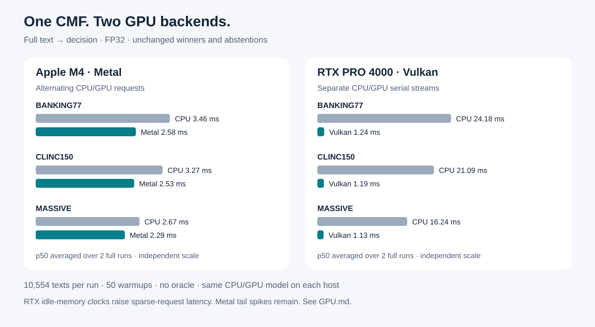

Русский: [README.ru.md](README.ru.md) · 中文: [README.zh.md](README.zh.md)

# CMF — Cortiq Model Format

CMF is an auditable model container: one file can hold weights, tokenizer,
chat metadata, task masks and skill overlays for inference without a large
framework runtime.

[](https://github.com/infosave2007/cmf/actions/workflows/ci.yml)
[](https://crates.io/crates/cortiq-core)
[](https://docs.rs/cortiq-core)
[](LICENSE)

## CMF against other formats

The table scores the file format and its reference runtime out of 100. Each
criterion gets 0–100 and a weight. The weights are ours and printed, so you can
recompute the totals for your own needs. Ecosystem size (how many models are
already published, how many third-party tools exist) is not a property of the
file, so it is not scored.

| criterion | weight | CMF | GGUF | safetensors | ONNX | MLX | EXL3 | PyTorch `.pt` |
|---|---:|---:|---:|---:|---:|---:|---:|---:|
| **Quantization range**: encodings the format itself defines, from 16 bits to below 1 bit | 15 | **100** | 90 | 30 | 50 | 60 | 70 | 25 |
| **Mixed codecs in one file**: any codec on any tensor, re-quantization in place | 10 | **100** | 90 | 50 | 60 | 70 | 75 | 30 |
| **Empty weights take no space**: pruned neurons and experts are not stored, every layer keeps its own width | 15 | **100** | 45 | 30 | 60 | 25 | 25 | 30 |
| **Flexibility, many tasks on one base**: task masks, skills and expert routing inside one file | 15 | **100** | 40 | 35 | 20 | 30 | 20 | 35 |
| **Self-contained file**: tokenizer, chat template, multi-component pipelines | 10 | **100** | 80 | 30 | 45 | 30 | 25 | 25 |
| **Integrity and authenticity**: content hashes, verification, signature | 10 | **100** | 30 | 55 | 35 | 50 | 50 | 10 |
| **Zero-copy, lazy loading**: mmap, the GPU reads the mapped file, experts on demand | 10 | **100** | 90 | 85 | 40 | 80 | 60 | 40 |
| **Safe evolution**: an old reader refuses what it cannot run | 5 | **100** | 70 | 60 | 85 | 50 | 40 | 40 |
| **Standalone runtime**: no Python or ML framework, CPU and GPU | 10 | 90 | **100** | 30 | 70 | 50 | 15 | 0 |
| **Weighted total** | **100** | **99** | 69 | 42 | 49 | 48 | 42 | 26 |

The evidence behind the CMF column:

- **17 weight encodings in one directory.**
  - Float: f32, f16, bf16.
  - 8-bit: `q8_row`, and `q8_2f` with row and column scales.
  - 4-bit: `q4_block`, `q4t`, `q4tp` (predicted scales, 4.17 bits/weight), and `mxfp4` (re-packs OCP MXFP4 checkpoints without loss).
  - Variable 3–8 bits: `vbit` and `vbit_ro`.
  - 2-bit: `q2tp`.
  - Ternary: `q1t`.
  - Binary: `q1`, `q1g` (1.125 bits/weight), and `q1s` (binary plus outliers).
  - Below 1 bit/weight: binary low-rank `blr`.
- **Any encoding on any tensor.** Every directory entry carries its own dtype.
  `--tensor-quant PATTERN=CODEC` picks codecs at conversion. `cortiq requant`
  changes them in an existing file without going back to the source checkpoint.
- **Empty weights take no space.** A pruned FFN neuron or MoE expert is neither
  stored nor computed. Each layer keeps its own width and its own expert count,
  because the reader takes sizes from tensor shapes, not from one global number
  ([spec §11](docs/CMF_V2_SPEC.md)). Experts and skills the current task does
  not use are never read from disk.
- **Many tasks on one base.**
  - A task mask costs 1 bit per FFN neuron, attention head, layer and expert.
  - Skills are replacement tensors in the same file and take memory only when used.
  - A skill can also ship as a separate small file, bound to its base by hash.
- **One file, pipelines included.** The tokenizer and chat template are stored
  in the file. Image-editing models (transformer, text encoder, VAE and
  scheduler), video models and speech models are single files too.
- **Integrity.** Every tensor and every section has a hash. `cortiq verify`
  checks the whole chain, and an optional Ed25519 signature comes from
  `cortiq sign`. A damaged file refuses to open instead of producing garbage.
- **Loading.**
  - Weights are page-aligned and tensors 64-byte aligned, and the file is memory-mapped.
  - On Apple silicon the GPU reads tensors straight from the mapping, with no copy.
  - MoE experts are paged in when the router picks them.
- **Safe evolution.** Every new capability gets a required-feature bit. A reader
  that does not know a bit refuses the file instead of guessing.
- **Runtime.** Written in Rust with no Python, it runs on CPU, Metal and
  Vulkan/DX12. A separate Python reader (stdlib + numpy) is also provided.
  `cortiq import-gguf` converts GGUF files directly. CMF scores 90 rather than
  100 in the last row because llama.cpp also has CUDA, ROCm and SYCL back ends.

The criteria, and the reasoning behind every other format's score, are in
[docs/COMPARISON.md](docs/COMPARISON.md).

## Decisions on Metal and Vulkan

**Cortiq 0.8.0:** one CMF file with trainable skills, local decisions by
reconstruction error — no token generation. CPU by default; select a GPU with
`CORTIQ_DECISION_DEVICE=metal` or `vulkan`. The standard crates.io installation
includes GPU support (Rust 1.88+).



[Quick start, custom skills and API](docs/decision/hf/README.md) ·
[Measurements and limits](docs/decision/hf/GPU.md)

## Status

CMF v2 is the current on-disk format. Readers validate the envelope, section
bounds, tensor metadata and hashes; incompatible changes require a feature bit
or version bump. The Rust crate APIs are still pre-1.0 and may change.

The project is usable for local inference and format experiments. Treat model
quality and speed numbers as workload-specific measurements, not guarantees;
see the focused guides for the test setup behind each claim.

## Quick start

Install the CLI and convert a small public checkpoint:

```sh
cargo install cortiq-cli --locked
cortiq convert --model Qwen/Qwen3-0.6B --quant q8 --output qwen.cmf
cortiq run qwen.cmf --prompt "What is the capital of France?" --greedy --no-think
```

Already have GGUF? Import it directly:

```sh
cortiq import-gguf model.gguf --output model.cmf
cortiq verify model.cmf
```

Serve it as an OpenAI-compatible API (chat and completions, streamed or not, a web dashboard on the same
port; `--host 127.0.0.1` keeps it local):

```sh
cortiq serve model.cmf --port 8080
curl http://localhost:8080/v1/chat/completions -H "Content-Type: application/json" \
  -d '{"model": "cmf", "messages": [{"role": "user", "content": "Hello"}]}'
```

## Z-Image on CUDA (0.8.83)

[Z-Image-Turbo](https://huggingface.co/infosave/Z-Image-Turbo-cmf) and [Z-Image](https://huggingface.co/infosave/Z-Image-cmf)
now run their transformer on CUDA, a step as one call on the card; before, `CMF_GPU=cuda` ran it on the host. On
an RTX A5000 Turbo draws a 1024×1024 picture in 8 steps in 12.1 s on CUDA and 13.0 s over Vulkan:

```sh
CMF_GPU=cuda cortiq imagine z-image-turbo.cmf --prompt "A red fox sitting in fresh snow at sunset" --out fox.png
```

## Qwen-Image-2.1 on CUDA (0.8.82)

[Qwen-Image-2.1](https://huggingface.co/infosave/Qwen-Image-2.1-cmf) now runs on CUDA too, its transformer steps
against the prompt's cached keys and values and its VAE decoder each as one chain on the card. On an RTX A5000
a 1024×1024 picture in 40 steps takes 53.0 s on CUDA (before, the transformer ran on the host at 65 s a
step) and 69.8 s over Vulkan:

```sh
CMF_GPU=cuda cortiq imagine qwen-image-2.1.cmf --prompt "A red fox sitting in fresh snow at sunset" --out fox.png
```

## MOSS-Image on CUDA, Vulkan and Metal (0.8.81)

[MOSS-Image](https://huggingface.co/infosave/MOSS-Image-SFT-cmf) runs every block of a DiT pass on the card in one
call on all three backends, q4tp and q8_2f alike; on CUDA the Flux2 VAE decoder runs as one chain too. On an
RTX A5000 a 512×512 picture in 8 steps takes 10.1 s on CUDA (was 297.1 s) and 17.3 s over Vulkan (was 414.7 s);
the 50-step 1024×1024 recipe takes 123.1 s on CUDA. A MacBook Air M4 draws the 512×512 picture in 69.8 s (was
123.7 s):

```sh
CMF_GPU=cuda cortiq imagine moss-image-sft-q4tp.cmf --prompt "A small red fox reading a book in a sunlit library" \
  --width 1024 --height 1024 --steps 50 --cfg 3 --shift 5 --out fox.png
```

## Qwen-Image-Edit-2509 on CUDA, faster on Vulkan (0.8.80)

[Qwen-Image-Edit-2509](https://huggingface.co/infosave/Qwen-Image-Edit-2509-cmf) now keeps every transformer block
of a step on the card in one call over CUDA, and over Vulkan on the H3 chain's matrix kernels. On an RTX A5000 a
1024×1024 edit in 8 steps with guidance takes 105.8 s on CUDA (was 464 s) and 148.1 s over Vulkan (was 442.5 s);
on CUDA it fits an 8 GB card (`CMF_GPU_VRAM_MB=8000`, 115.1 s):

```sh
CMF_GPU=cuda cortiq imagine qwen-image-edit-2509-q4tp.cmf --image input.png --prompt "Add a blue knitted scarf." \
  --height 1024 --width 1024 --steps 8 --cfg 4 --reference-size 1024 --out edited.png
```

## Lumina-Image 2.0 on CUDA (0.8.79)

[Lumina-Image 2.0](https://huggingface.co/infosave/Lumina-Image-2.0cmf) runs a whole transformer block on the card
in one call over CUDA, as it already did over Vulkan and Metal. On an RTX A5000 a 512×512 picture in 30 steps
with guidance takes 40.5 s on CUDA (was 332.2 s) and 55.4 s over Vulkan:

```sh
CMF_GPU=cuda cortiq imagine lumina-q4tp.cmf --prompt "a red fox sitting in snow at sunset" --out fox.ppm
```

## LTX-2.5 on CUDA and Vulkan: a clip with sound in 24 s (0.8.77)

[LTX-2.5](https://huggingface.co/infosave/LTX-2.5-cmf), video and its soundtrack from one prompt, now runs its 48
audio-video blocks as one resident chain on the card, and its video VAE on the card too. On an RTX A5000 a
384×256 clip of 49 frames with sound takes 22.3 s on CUDA and 28.9 s over Vulkan once the prompt is encoded
(it is cached); 0.8.76 took 430 to 475 s for the picture alone. This release also fixes the first call of every
resident chain on CUDA, which could read weights still being copied:

```sh
cortiq ltx-video --model ltx25-q4tp.cmf --prompt "A corgi in a chef hat flips a pancake." \
  --height 256 --width 384 --frames 49 --out corgi.y4m --out-audio corgi.wav
```

## MiniMax-H3-Turbo on CUDA, faster on Vulkan and Metal (0.8.76)

[MiniMax-H3-Turbo](https://huggingface.co/infosave/MiniMax-H3-Turbo-cmf), video with synchronized audio from one
prompt, now runs its transformer as one resident chain on the GPU, as MiniMax-H3-Image does. On an RTX A5000 a
512×288 clip of 39 frames in four steps takes 19.5 s on CUDA (was 165.1 s) and 25.8 s over Vulkan (was 97.2 s);
within 4 GB of the card's memory CUDA takes 22.4 s. A MacBook Air M4 renders 512×256 in 157 s instead of 183 s.
This release also fixes `cortiq animate` on Vulkan cards with 24 GB, which ran out of memory in 0.8.75:

```sh
cortiq animate mmh3-turbo-q4tp.cmf --prompt "A corgi in a chef hat flipping a pancake." --out corgi.avi
CMF_GPU=cuda CMF_GPU_VRAM_MB=4000 cortiq animate mmh3-turbo-q4tp.cmf --prompt "…" --out clip.avi
```

## MiniMax-H3-Image on Vulkan and Metal (0.8.75)

[MiniMax-H3-Image](https://huggingface.co/infosave/MiniMax-H3-Image-cmf) now keeps the image on the GPU from the
transformer's first block to its last on Vulkan and on Apple silicon too, as it did on CUDA. On an RTX A5000 the
default backend, Vulkan, renders 2048×2048 in 33.7 s where 0.8.74 took 260.1 s (CUDA: 24.8 s), and an edit of a
1024×1024 picture in 30.6 s instead of 164.5 s. `CMF_GPU_VRAM_MB` is a ceiling on Vulkan as well: 2048×2048 in
46.8 s within 4 GB, the same picture bit for bit. A MacBook Air M4 with 24 GB renders 1024×1024 in 138.8 s
instead of 305.2 s:

```sh
cortiq imagine minimax-h3-image-q4tp.cmf --prompt @prompt.txt --out out.png
CMF_GPU_VRAM_MB=8000 cortiq imagine minimax-h3-image-q4tp.cmf --prompt @prompt.txt --out out.png
```

See [the guide](docs/MINIMAX_H3_IMAGE.md).

## MiniMax-H3-Image, text to image and image editing (0.8.73)

[MiniMax-H3-Image](https://huggingface.co/infosave/MiniMax-H3-Image-cmf) generates and edits images of 4 to 16
megapixels in six steps. One 24.6 GB file holds the 20B diffusion transformer and the Qwen3-VL prompt encoder
in 4 bits and the VAE in 8. On a 16 GB RTX 2000 Ada the CUDA backend renders 2048×2048 in 50.3 s, and under a
4 GB ceiling on the card's memory in 60.2 s, the same picture:

```sh
CMF_GPU=cuda cortiq imagine minimax-h3-image-q4tp.cmf --prompt @prompt.txt --out out.png
CMF_GPU=cuda cortiq imagine minimax-h3-image-q4tp.cmf --image photo.png --prompt @edit.txt --out edit.png
CMF_GPU=cuda CMF_GPU_VRAM_MB=4000 cortiq imagine minimax-h3-image-q4tp.cmf --prompt @prompt.txt --out out.png
```

See [the guide](docs/MINIMAX_H3_IMAGE.md). The model is under the MiniMax-H3-Image Community License.

## Dory Turbo with a fixed ceiling on CUDA (0.8.72)

The turbo file of [Nemotron Labs Dory 1.0 4B](https://huggingface.co/infosave/Nemotron-Labs-Dory1.0-4B-cmf) now keeps
a fixed ceiling on CUDA too, the prompt included: on a 16 GB RTX 2000 Ada the card holds 3.8 GB from 16 000 to
64 000 tokens, where 0.8.71 reached 7.5 GB. A prompt past its first 8 192 rows is read through the far field in
chunks, so 64 000 tokens reach the first token in 33 s against 69 in 0.8.71 and 306 over Vulkan. Decode stays at
80 tok/s, and facts planted in 100 000 characters are found 8 times of 8.

```sh
cargo install cortiq-cli --features cuda
CMF_GPU=cuda cortiq run dory-turbo.cmf --prompt-file report.txt --greedy --no-think
CMF_GPU=cuda CMF_MAX_SEQ=131072 cortiq serve dory-turbo.cmf --port 8080 --host 127.0.0.1   # OpenAI-compatible API
```

See [docs/CUDA.md](docs/CUDA.md#dory-on-a-16-gb-card); the server is in [docs/DORY.md](docs/DORY.md#server).

## Qwen3.8-27B Turbo on a 16 GB card through CUDA (0.8.71)

[Qwen3.8-27B Turbo](https://huggingface.co/infosave/Qwen3.8-27B-Turbo-cmf) now keeps a fixed ceiling on CUDA, the
prompt included: on a 16 GB RTX 2000 Ada the whole run stays within 15.0 GB from 1 000 to 64 000 tokens. A prompt
past the first rows is read through the far field in chunks, as over Vulkan, and the far field's sums are built on
the card. On the same card a 64 000-token prompt reaches the first token in 175 s against 278 over Vulkan, and a
summary of 100 000 characters decodes at 31.5 tok/s against 21.3. The standard file does not fit 16 000 tokens
there.

```sh
cargo install cortiq-cli --features cuda
CMF_GPU=cuda cortiq run qwen38-27b-turbo.cmf --prompt-file report.txt --greedy --no-think
```

See [docs/CUDA.md](docs/CUDA.md#turbo-on-a-16-gb-card).

## Dory and Qwen3.8-27B Turbo on CUDA (0.8.70)

The CUDA backend runs [Nemotron Labs Dory 1.0 4B](https://huggingface.co/infosave/Nemotron-Labs-Dory1.0-4B-cmf), the
looped nGPT, its turbo file included: on an RTX 3090 the turbo file answers at 201 tok/s against 121 over Vulkan
on the same card, and reads 64 000 tokens in 33 s against 163. [Qwen3.8-27B
Turbo](https://huggingface.co/infosave/Qwen3.8-27B-Turbo-cmf) now drafts past its seal on CUDA: a summary of
100 000 characters decodes at 80 tok/s against 42, the same text.

```sh
cargo install cortiq-cli --features cuda
CMF_GPU=cuda cortiq run dory-turbo.cmf --prompt "Write a Rust function that reverses a list." --no-think
```

See [docs/CUDA.md](docs/CUDA.md#dory-the-looped-ngpt).

## Qwen3.8-27B on CUDA: chat at 120–128 tok/s on an RTX 3090 (0.8.69)

The CUDA backend runs Qwen3.5-family hybrids (GDN mixers plus gated attention) with drafts and their verify on
the card. On an RTX 3090 [Qwen3.8-27B](https://huggingface.co/infosave/Qwen3.8-27B-cmf) in four bits decodes
chat at 120.2 tok/s with its MTP head and at 128.4 with the DFlash 2 drafter beside it (57.7 over Vulkan), plain
at 49.1 (40.8), and reads a 4 000-token prompt at 983 tok/s (560). The text with drafts is the text without them.
A chat's next turn reads only the new message. The same runs for
[Arete-27B Turbo](https://huggingface.co/infosave/Arete-27B-Turbo-cmf) (no MTP head: DFlash takes code from 49 to
102 tok/s) and [OrcaCyber-Nano-1.0 Turbo](https://huggingface.co/infosave/OrcaCyber-Nano-1.0-Turbo-cmf), each
with its drafter on Hugging Face. The Fast Code stack runs on CUDA too.

```sh
cargo install cortiq-cli --features cuda
hf download infosave/Qwen3.8-27B-cmf qwen38-27b-q4tp.cmf qwen38-27b-q4tp.dflash.cmf --local-dir .
CMF_GPU=cuda CMF_DFLASH=1 cortiq serve qwen38-27b-q4tp.cmf --port 8080 --host 127.0.0.1
```

See [docs/CUDA.md](docs/CUDA.md#hybrids-the-qwen35-family).

## A CUDA backend for NVIDIA cards (0.8.67)

A native CUDA backend beside wgpu and Metal, experimental and off by default: build with `--features cuda`,
select with `CMF_GPU=cuda`. Nothing is linked: the kernels are CUDA C compiled at first use, the prompt runs
on cuBLAS. It covers dense attention stacks of the Spark-X2.x class, a turbo file's far field included.
[Spark-X2.6-4B Turbo](https://huggingface.co/infosave/Spark-X2.6-4B-turbo-CUDA-cmf) in four bits on an NVIDIA
A40 reads a 4 000-token prompt at 6096 tok/s and decodes at 111.5 tok/s (3789 and 80.2 over Vulkan); after a
64 000-token prompt it gives the first token in 42.3 s and decodes at 100.7 tok/s in 3.9 GB of the card (60.3 s
and 85.9 tok/s over Vulkan):

```sh
cargo install cortiq-cli --features cuda
CMF_GPU=cuda CMF_MAX_SEQ=131072 cortiq serve spark-x2.6-4b-q4tp-turbo.cmf --port 8080 --host 127.0.0.1
```

See [docs/CUDA.md](docs/CUDA.md).

## Ripple-65B Preview, a dense 65B in three files (0.8.60)

[Ripple-65B Preview](https://huggingface.co/infosave/Ripple-65B-Preview-cmf) in four bits (34.6 GB), two bits
(29.2 GB) and eight bits (64.8 GB), each file with the turbo header: on an NVIDIA A40 (46 GB) the four-bit file
decodes at 12 tok/s from 4 000 to 64 000 tokens of prompt at 35 to 37 GB. On an RTX PRO 6000 it decodes at 29.8
tok/s (23.4 before this release), the eight-bit file reads a prompt at 156 tok/s against 43:

```sh
cortiq run ripple-65b-q4tp.cmf --prompt-file report.txt --greedy
```

A DFlash 2 drafter comes beside it (`CMF_DFLASH=1`), its block one device submission: code 30.2 → 46.6 tok/s
on the RTX PRO 6000, prose about even. See [the card](docs/hf/Ripple-65B-Preview-cmf.md).

## Qwen3.8-27B Turbo, drafts on a Mac and in a chat (0.8.59)

On a MacBook Air M4 (24 GB, no fan, the base M4's memory bus)
[the turbo file](https://huggingface.co/infosave/Qwen3.8-27B-Turbo-cmf) decodes at 6.4 tok/s; with drafts it is
10 to 20, and the Neural Engine (`CMF_ANE=1`) reads a prompt of 3 600 tokens in 28 s against 74. Both switches are
off by default:

```sh
CMF_GRAPH_SPEC=1 cortiq run qwen38-27b-turbo.cmf --prompt-file report.txt --greedy --no-think
```

On Vulkan the depth of the draft chain follows what a round costs on the card: a chat on a 16 GB card runs at
29.8 tok/s against 26.5. See [the guide](docs/QWEN38_TURBO.md).

## Qwen3.8-27B Turbo, a fixed ceiling on the card (0.8.58)

[The turbo file](https://huggingface.co/infosave/Qwen3.8-27B-Turbo-cmf) keeps device memory in place on long
prompts, and a long prompt's rows go to RAM or to a fast SSD as they are read. It fits a 16 GB card at any
prompt length. On an RTX 5090, at 64 000 tokens: 15.7 GB against 22.8 GB, first token 177 s against 316 s, decode
92 tok/s against 51, with passwords and codes in the text still exact:

```sh
cortiq run qwen38-27b-turbo.cmf --prompt-file report.txt --greedy --no-think --o1-spill /mnt/ssd/cortiq
```

See [the guide](docs/QWEN38_TURBO.md).

## Nemotron-Labs Dory 1.0 4B, a looped transformer (0.8.57)

[Dory](https://huggingface.co/infosave/Nemotron-Labs-Dory1.0-4B-cmf) runs a block of 40 sub-layers
several times over the same weights. The 2.09 GB turbo file picks one pass or two for each token with
a resonance router, keeps a long prompt in 0.5 GB of device memory, and keeps passwords and codes
exact, chosen by what the layers do with them. An NVIDIA L4 decodes at 61 tok/s on real prompts and at
54 tok/s at 64 000 tokens of context, a MacBook Air M4 at 33 and at 29 at 16 000:

```sh
cortiq run dory-turbo.cmf --prompt "Write a Rust function that reverses a list." --no-think
```

See [the guide](docs/DORY.md).

## Kandinsky S2V 1.0 Pro-distill, speech to video (0.8.55)

[Kandinsky S2V](https://huggingface.co/infosave/Kandinsky-S2V-1.0-Pro-distill-cmf)
turns a reference frame and a speech track into an avatar video where the whole figure
moves. One 24 GB file holds the 21B DiT, the speech and text encoders, CLIP and the VAE.
An L40S renders 5 s of 512×512 video in 5.6 minutes at 16.2 GB of VRAM, a MacBook Air M4
in 4.45 hours at 14.6 GB of unified memory:

```sh
cortiq s2v --model kandinsky-s2v-pro-q4tp.cmf --image reference.png --audio speech.wav --out avatar.avi
```

See [the guide](docs/KANDINSKY_S2V.md).

## Unlimited-OCR-2 and MiniCPM-OCR-1.0 (0.8.54)

Two OCR models. [Unlimited-OCR-2](https://huggingface.co/infosave/Unlimited-OCR-2-cmf)
parses a whole document in one pass: its attention reads at most 512 tokens per
step however long the document is. An RTX PRO 4500 decodes at 320 tok/s through 24
pages, a 10-core M4 at 95–112. [MiniCPM-OCR-1.0](https://huggingface.co/infosave/MiniCPM-OCR-1.0-cmf)
recognizes a page or a region at 254–267 tok/s, on the M4 at 73–102:

```sh
cortiq run unlimited-ocr-2-q8_2f.cmf --image page1.png --image page2.png --prompt "Multi page parsing." --max-tokens 8192
cortiq run minicpm-ocr-1.0-q8_2f.cmf --image page.png --prompt "Text Recognition:" --max-tokens 2048
```

## Embryo-56M, a small model in its own architecture (0.8.53)

[Embryo-56M](https://huggingface.co/infosave/Embryo-56M-cmf) has 56 million
parameters, born and trained from scratch on one laptop GPU with no foreign
weights: gated delta mixers and two bounded anchors, 10.1 MB of state at any
context length, a 91 MB q8_2f file. It answers facts verbatim from records chosen
by the reconstruction router, follows up on them, and refuses a factual question
it has no record for. Outside the records it is a very small model: grammatical,
short, often empty.

| tok/s | decode | after 2000 tokens | prefill |
|---|---|---|---|
| Apple M4 GPU | 650 | 535 | 820 |
| Apple M4 CPU | 470 | 379 | 430 |
| RTX 2000 Ada | 925 | 796 | 1230 |
| EPYC 7443P | 612 | 405 | 233 |

This is the first experimental version of a model built entirely on the
technologies of Oleg Kirichenko. Larger models for different tasks and the
mechanisms for training models will follow.

How it is assembled and what each gate measures: [docs/EMBRYO_CHAT.md](docs/EMBRYO_CHAT.md).

## Clover-35B-A3B-Preview decodes causally (0.8.52)

The block-diffusion model now takes its ordinary causal path by default, with
the release's response penalties: `q4tp-v2` runs at 120 tok/s on an RTX 5090
on both prose and code, 53 on a 16 GB budget, 13–18 on a Mac mini M4 (24 GB;
the prompt on Metal at ~170 tok/s, the rows on the CPU). `CMF_CLOVER_MODE=denoise`
keeps LowConfidence block denoising and `CMF_CLOVER_MODE=draft` adds the
vendor's self-speculation; the three are compared in [docs/CLOVER.md](docs/CLOVER.md).

## SenseNova-Loop, Mage-VL-Cowork and Primal VAE (0.8.51)

[SenseNova-Loop-9B-Preview](https://huggingface.co/infosave/SenseNova-Loop-9B-Preview-cmf)
runs a block of 24 decoder layers twice with shared weights and two mHC residual
streams inside the loop; [Mage-VL-Cowork](https://huggingface.co/infosave/Mage-VL-Cowork-cmf)
is Microsoft's 4B computer-use agent over native-resolution screenshots;
[Primal VAE](https://huggingface.co/infosave/primal_vae-cmf) is Ostris's
1–2-channel 2× image autoencoder:

```sh
cortiq run sensenova-loop-9b-q4tp.cmf --image photo.jpg --prompt "Describe this image." --no-think
cortiq run mage-vl-cowork-q8_2f.cmf --image screen.png --prompt "Task: open the Downloads folder."
cortiq vae --model primal_vae_2x2.cmf --mode roundtrip --input photo.png --output recon.png
```

Greedy text and the vision rows match Transformers float32. Both vision towers
run on the GPU (Vulkan and Metal); the loop and mHC run inside the wgpu and
Metal token graphs; the VAE encodes or decodes a 1024×1024 image in one GPU
submission (0.40 / 0.29 s on an NVIDIA A40).

## Liquid AI LFM3 speech, Omni and d1 (0.8.50)

[LFM3-Audio-2B](https://huggingface.co/infosave/LFM3-Audio-2B-cmf) transcribes
and speaks (19 TTS languages, interleaved voice chat),
[LFM3-Omni-2B](https://huggingface.co/infosave/LFM3-Omni-2B-cmf) adds pictures
and video, and the decision models
[d1-2B](https://huggingface.co/infosave/d1-2B-cmf) and
[d1-Omni-2B](https://huggingface.co/infosave/d1-Omni-2B-cmf) answer named
questions about a state from one forward pass:

```sh
cortiq run lfm3-audio-2b-q8_2f.cmf --system "Perform ASR in English." --audio clip.wav --prompt ""
cortiq run lfm3-audio-2b-q8_2f.cmf --system "Perform TTS in American English using a female voice." \
  --prompt "Hello! How are you today?" --speech-out hello.wav
cortiq system-one d1-2b-q8_2f.cmf --state "I was charged twice and my parcel never arrived." \
  --questions '{"refund": {"type": "noul", "instructions": "Is this a refund request?"}}'
```

Transcripts match Transformers word for word and an f16 file reproduces its
speech frames exactly; the codec travels inside the file. d1's whole pass runs
in one GPU submission: one question in ~45 ms on an NVIDIA A40 and 79 ms on an
Apple M4. On Apple silicon the Metal token graph now takes LFM3's short
convolutions: LFM3-1.7B q4tp decodes 84 tok/s on an M4 (was 61).

## Liquid AI LFM3 (0.8.49)

[LFM3-1.7B](https://huggingface.co/infosave/LFM3-1.7B-cmf), Liquid AI's
tri-hybrid model for local agents and tool calling (short convolutions, full
and sliding-window attention, 262k context), its pre-trained
[Base](https://huggingface.co/infosave/LFM3-1.7B-Base-cmf) and the
vision-language [LFM3-VL-2B](https://huggingface.co/infosave/LFM3-VL-2B-cmf)
(images and video):

```sh
hf download infosave/LFM3-1.7B-cmf lfm3-1.7b-q8_2f.cmf --local-dir .
cortiq run lfm3-1.7b-q8_2f.cmf --prompt "Write a Python function that merges two sorted lists." --max-tokens 2048
cortiq run lfm3-vl-2b-q8_2f.cmf --image photo.jpg --prompt "Describe this image." --max-tokens 1024
```

The conversion matches Transformers float32 position for position. On an
NVIDIA A40 the 8-bit file decodes at 166 tok/s and the 4-bit one at 231 tok/s;
a 4096-token prompt reads at ~600 tok/s. The same release passes `bos_token` to
chat templates, which LFM2/LFM2.5/LFM3 prompts were missing.

## Apex-35B-V1.0 and faster Qwen3.5-MoE graphs (0.8.48)

[Apex-35B-V1.0](https://huggingface.co/infosave/Apex-35B-V1.0-cmf), an agentic
fine-tune of Qwen3.6-35B-A3B with tool calling and dynamic thinking:

```sh
hf download infosave/Apex-35B-V1.0-cmf apex-35b-v1.0-q4tp-v2.cmf --local-dir .
cortiq run apex-35b-v1.0-q4tp-v2.cmf --prompt "Write a Python function that merges two sorted lists." --max-tokens 4096
```

On an NVIDIA A40 the 4-bit file decodes at 80 tok/s and reads a 4096-token
prompt at ~390 tok/s (first token in 10.5 s). The same release speeds up every
Qwen3.5/3.6-MoE stack on Vulkan: the prompt of a q4tp MoE is read in 256-row
chunks, speculation stays off where the MoE draft block would run on the host,
and the token graph builds each layer's expert bank once instead of every
token (Apex q4tp-v2: decode 52.9 → 80.3 tok/s, 4096-token prompt 172 → 390
tok/s against 0.8.45).

## Spark-X2.6 on a Mac (0.8.43–0.8.44)

[Spark-X2.6-4B](https://huggingface.co/infosave/Spark-X2.6-4B-cmf) on a Mac
mini M4 (24 GB): the default q8_2f file prefills a 1000-token prompt at ~205
tok/s and decodes at 16–19 tok/s; the q4tp file decodes at ~30 tok/s. A chat
turn through `cortiq serve` prefills only what changed since the previous
turn (2.3k-token history: 0.6 s instead of 11 s). Measurements and the
rejected levers: [docs/SPARK26_METAL.md](docs/SPARK26_METAL.md).

An Intel Mac with a Radeon Pro runs the same model on its GPU through wgpu:
`CMF_GPU=wgpu cortiq run ...` (the native Metal path needs unified memory and
falls back to the CPU there). Spark-X2.6-4B q4tp on a Radeon Pro 560X decodes
at ~16 tok/s against ~10 on the Mac's i9 (0.8.44).

## Block-diffusion models (0.8.40)

[Clover-35B-A3B-Preview](https://huggingface.co/infosave/Clover-35B-A3B-Preview-cmf)
writes its answer in 32-token blocks, resolving several tokens a pass by
denoising instead of one token a step:

```sh
hf download infosave/Clover-35B-A3B-Preview-cmf clover-35b-a3b-preview-q4tp-v2.cmf --local-dir .
cortiq run clover-35b-a3b-preview-q4tp-v2.cmf --prompt "Write a Python function that merges two sorted lists." --no-think
```

With `CMF_CLOVER_MODE=denoise`, every denoising pass on Vulkan is one GPU
submission (34 ms for a 32-token block on an RTX 5090: ~26 tok/s on prose,
80–95 on code at the release's threshold) and on Apple silicon the passes run
on Metal (Mac mini M4, 24 GB: 3.2 tok/s on prose, 6.5–9 on code). Converting, the generation controls and the measurements:
[docs/CLOVER.md](docs/CLOVER.md). The same release cuts the VRAM of every
MoE graph on Vulkan: a 35B-A3B q4tp stack takes 18.8 GB instead of 31.8 GB,
and the published Qwen3.6-35B-A3B decodes at 156 tok/s on a 32 GB card.

## Task compression in one command (0.8.39)

Turn a general model into a specialist for your prompts:

```sh
cortiq compress model.cmf prompts.jsonl model-task.cmf --ratio 0.9
```

The teacher answers the prompts (the model itself, another `.cmf`, or any
OpenAI-compatible API: `--teacher openrouter:qwen/qwen3.8-27b`, `openai:MODEL`,
`api:MODEL --api-base URL`); the FFN neurons the task does not use leave the
model (by activation illumination, or by a trained DTG-MA mask with
`--select dtgma`), their contribution is refit into the kept ones in closed
form, and the model is healed on the answers; held-out answers score it and
gate the output. MoE models drop the experts the task does not route to. The
output keeps the source's codec — quantize it separately. The device stages run
on NVIDIA (Vulkan) and on Apple Silicon (Metal) — since 0.8.42 the fold itself
too: one Qwen3.8-27B layer folds in 12 s on a Mac mini M4 instead of ~11 min
on its CPU, and with `--keep-grams` several target sizes fold from one
illumination. See the [compress guide](docs/COMPRESS.md); the method and its
measurements are in the [task-compression article](docs/research/TASK_COMPRESSION_ARTICLE.md),
and a full run on a large model in
[Qwen3.8-27B → 14B, step by step](docs/research/QWEN38_27B_TASK_COMPRESSION.md)
(the resulting model, its prompts and teacher dataset:
[infosave/Qwen3.8-27B-Code-14B-Experimental-cmf](https://huggingface.co/infosave/Qwen3.8-27B-Code-14B-Experimental-cmf)).

## Prompt-calibrated MTP draft compaction (0.8.38)

For a CMF that already carries a supported dense MTP draft, create a smaller
draft calibrated to representative task prompts with one command:

```sh
cortiq compact source.cmf prompts.jsonl task-model.cmf
```

The source is used as the teacher and the command creates or reuses
`task-model.tdata`, writes an auditable plan, and verifies the runnable output.
It is physical MTP-draft compaction, not general fine-tuning: trunk weights and
greedy output remain verifier-controlled. See the [MTP compaction guide](docs/MTP_COMPACTION.md)
for JSONL input, safety gates, and Metal/Vulkan validation.

## Tencent Hy-MT2 (HunYuan)

Version 0.7.0 adds the HunYuan architectures — the dense `hunyuan_v1_dense`
(Hy-MT2-1.8B / 7B) and the `hy_v3` MoE (Hy-MT2-30B-A3B) — including the
family's q/k-norm-after-RoPE attention order and NTK-alpha RoPE base, and an
exact `import-gguf` path for Tencent's 1.25-bit `STQ1_0` checkpoint into `q1t`.
Ready files: [infosave/Hy-MT2-cmf](https://huggingface.co/infosave/Hy-MT2-cmf).
0.7.0 also fixes the 0.6.9 crash on any non-Prism file with a 4-bit embedding.
0.7.1 puts the 30B's prompt through the resident graph on discrete cards
(8 → 65 tok/s of ingest) and its experts on the GPU on a 24 GB Mac, whose
Metal buffer cap splits the 15.8 GB file into windows (17.9 → 32 tok/s).

## Native Qwen Image Edit

Version 0.6.9 adds the native Qwen-Image-Edit-2509 path and the explicit `q2tp_affine` Prism profile. The ready default is
one self-contained CMF, while the standalone component files remain available
when users want to stage them independently. Build the bundle from a directory
that contains `transformer.cmf`, `text_encoder.cmf`, `vae.cmf`, and
`scheduler_config.json`:

```sh
cortiq imagine-pack --bundle qwen-image \
  --out qwen-image/qwen-image-edit-2509-q4tp.cmf
```

The bundle embeds the transformer, Qwen2.5-VL text/vision encoder,
tokenizer/processor/configuration, VAE, and scheduler. Run it directly with no
companion files:

```sh
cortiq imagine qwen-image/qwen-image-edit-2509-q4tp.cmf \
  --image docs/media/fox-512.png \
  --prompt "Add a vivid blue knitted scarf while preserving the fox, pose, and snowy background." \
  --height 1024 --width 1024 --steps 40 --cfg 4 --seed 7 \
  --reference-size 1024 --out fox-scarf.png
```

The command requires at least one reference image; repeat `--image` for
additional references. PNG, JPEG, and PPM output are supported. `CMF_GPU=0`
forces the portable CPU path. The documented profile keeps
`--reference-size 1024`: this is the square root of the VAE reference area and
is independent of the requested output dimensions. On a capable Vulkan device,
`cortiq imagine` automatically selects the resident Qwen transformer forward:
hidden state stays on the device across transformer blocks and is read back once
at the end of each forward. CPU and Metal fallback paths remain available, and
the memory-budgeted admission chooses a compatible path when needed. See [the
Qwen Image guide](docs/QWEN_IMAGE.md) for pinned acquisition, standalone staging,
and bundle packing commands.

The standalone layout remains available for explicit component selection:

```sh
cortiq imagine qwen-image/transformer.cmf \
  --text-encoder qwen-image/text_encoder.cmf \
  --vae qwen-image/vae.cmf \
  --scheduler qwen-image/scheduler_config.json \
  --image docs/media/fox-512.png \
  --prompt "Turn the scene into a watercolor illustration." \
  --height 1024 --width 1024 --steps 40 --cfg 4 --seed 7 \
  --reference-size 1024 --out watercolor.png
```

For pinned sources and component packing, see [the Qwen Image guide](docs/QWEN_IMAGE.md).

The CLI also exposes `info`, `bench`, `ppl`, `serve`, `skill`, `moe-mask`,
`moe-defrag`, `requant`, `compact`, `sign`, `imagine`, `animate`, `s2v` and
`ltx-video`. Run `cortiq <command> --help` for flags and current limitations.

### Whisper transcription

Cortiq can convert a 128-bin Hugging Face Whisper checkpoint (including
large-v3 and large-v3-turbo) to CMF, then transcribe WAV audio without a Python
runtime:

```sh
cortiq convert --model openai/whisper-large-v3-turbo --quant q4tp \
  --output whisper-large-v3-turbo-q4tp.cmf
cortiq verify whisper-large-v3-turbo-q4tp.cmf
cortiq transcribe whisper-large-v3-turbo-q4tp.cmf interview.wav --language en
```

The Whisper q4tp profile keeps attention and the shared decoder token/output
matrix in q8_2f, feed-forward matrices in q4tp, and positional embeddings in
f16. It is a mixed-precision conversion, not a quality/parity guarantee; measure
WER on your languages and audio before deployment. WAV PCM/float is converted to
mono 16 kHz. Metal/wgpu are used when available; `CMF_GPU=0` forces CPU. Full
30-second context is the default; `CMF_WHISPER_TRIM_ENCODER=1` is experimental
and may affect recognition quality.

### Nemotron 3.5 Transcribe (0.8.47)

`cortiq-cli` 0.8.47 runs [NVIDIA Nemotron 3.5 Transcribe
30B-A4B](https://huggingface.co/nvidia/NVIDIA-Nemotron-3.5-Transcribe-30B-A4B)
end to end in Rust: log-mel front end, ASR encoder, Sortformer diarization with
its speaker cache, the Mamba-2/attention/MoE decoder and word timestamps. Ready
files are on [Hugging Face](https://huggingface.co/infosave/Nemotron-3.5-Transcribe-30B-A4B-cmf):

```sh
cortiq transcribe nemotron-3.5-transcribe-30b-a4b-q4tp.cmf meeting.wav
cortiq transcribe nemotron-3.5-transcribe-30b-a4b-q4tp.cmf meeting.wav --timestamps
cortiq transcribe nemotron-3.5-transcribe-30b-a4b-q4tp.cmf a.wav b.wav --stats
```

`--prompt` takes the model's instructions (clean transcript, `<spk:N>` speaker
tags, translation). On a GPU the decoder runs as a resident frame with
speculative decoding by its MTP layer; a card that cannot hold every routed
expert keeps the most used ones and computes the rest on the CPU
(`CMF_NEMO_EXPERT_GB` sets the budget). `cortiq convert --model <checkpoint dir>`
packs the NeMo checkpoint (`--quant q8_2f | q4tp | q2tp`).

### Phonon 40M multilingual text-to-speech (0.8.36)

`phonon-pack` and `tts` are introduced in **cortiq-cli 0.8.36**. The currently
published 0.8.35 crate and older releases do not expose either command. Do not
expect a bare `cargo install cortiq-cli` to provide them until the `v0.8.36` tag
and the 0.8.36 crates.io publication exist. After that release is published:

```sh
# Default installation includes GPU support and the Phonon bridge.
cargo install cortiq-cli --version 0.8.36 --locked

# Or build the portable CPU-only CLI while retaining Phonon support.
cargo install cortiq-cli --version 0.8.36 --locked \
  --no-default-features --features phonon
```

Package an upstream checkout only after accepting its terms, or download the
ready CMF through the Hugging Face API CLI:

```sh
hf download gradium/phonon-40m-multilingual --local-dir phonon-source
cortiq phonon-pack phonon-source --output phonon-40m-multilingual-q8.cmf

hf download infosave/phonon-40m-multilingual-cmf \
  phonon-40m-multilingual-q8.cmf --local-dir .
cortiq verify phonon-40m-multilingual-q8.cmf
cortiq tts phonon-40m-multilingual-q8.cmf "Bonjour, monde." \
  --lang fr --temperature 0.3 --seed 4242424242424242 --out bonjour.wav
```

The CMF stores the upstream Q8 GGUF, configuration, tokenizer, and default
voice latent byte-for-byte; synthesis uses Gradium's maintained `ptts` runtime
after Cortiq validates and materializes those entries. This is a bridge, not a
claim of a native Phonon reimplementation. The model accepts **only** `en`,
`fr`, `de`, `es`, and `pt`: it does not support Russian or automatic language
detection, and `--voice-file` takes a precomputed compatible latent rather than
recorded-audio voice cloning. The upstream payload is CC-BY-NC-4.0. See the
[model-card source](docs/hf/Phonon-40M-Multilingual-cmf.md) for provenance and
the [public test Space](https://huggingface.co/spaces/infosave/phonon-40m-multilingual-cmf-demo)
for the currently deployed demo.

## What a CMF file contains

- A fixed 128-byte envelope addressing every section.
- Header JSON with architecture, quantization defaults, chat metadata and
  provenance.
- A binary tensor directory with dtype, shape, offsets, lengths and `hash64`.
- A page-aligned weight blob that can be memory-mapped and read in place.
- Optional task masks, skill replacement tensors, tokenizer bytes and sparse
  indexes.

`cortiq verify` fails on malformed bounds or a hash mismatch; `python/cmf_reader.py`
is a small independent reader for inspection. The normative layout is in the
[CMF v2 specification](docs/CMF_V2_SPEC.md).

## Quantization

Quantization is selected per tensor, so sensitive tensors can stay at a higher
precision while large matrix blocks use a compact codec.

| Codec | Typical use |
|---|---|
| `f16`, `f32` | norms, embeddings and exact control tensors |
| `q8`, `q8_2f` | high-fidelity weights; `q8_2f` adds input-channel scales |
| `q4`, `q4t`, `q4tp` | general dense and MoE weights |
| `q2tp` | existing dtype-16 midrise four-level codec; zero is not an individual code |
| `q2tp_affine` | dtype-16 Prism profile with explicit `(c - 1) * s` affine operator; requires signed-Hadamard and affine metadata |
| `vbit`, `vbit_ro` | size-constrained or mixed-bit profiles |
| `q1`, `q1t`, `q1s` | trained binary or experimental ternary/PTQ paths |
| `q1g` | trained binary with the native 128-weight scale group (1.125 bpw); a lossless `requant --quant q1g` of such a `q1` file |

See [Q1T/PTQ](docs/Q1T_PTQ.md) for the experimental low-bit path and the
[quantization coverage matrix](docs/QUANT_COVERAGE.md) for codec support by
execution path.

The `q2tp_affine` profile is an explicit Prism/Bonsai operator, not a
reinterpretation of ordinary `q2tp`: its signed Hadamard descriptor and affine
feature metadata are required at load time, and older readers must reject it.
It preserves the public `q2tp` codec and its existing semantics unchanged.

## Runtime capabilities

- **CPU inference:** portable Rust implementation with memory-mapped weights.
- **GPU inference:** native Metal on macOS and wgpu backends (Vulkan/DX12)
  where the device and build support them. Use `CMF_GPU=1` to request GPU.
- **Long context:** optional `--o1` attention uses fixed-size state and trades
  memory growth for a measured quality delta; measure on your model.
- **Skills:** one backbone can carry task masks and replacement-tensor overlays;
  inactive overlays do not need a second full model copy.
- **MoE:** task masks and physical defragmentation can reduce the active expert
  set. Validate perplexity on held-out data before shipping a restriction.
- **Speculative decode:** supported MTP/draft paths are enabled only where the
  model metadata and measured acceptance make them useful.
- **Serving:** `cortiq serve` provides an OpenAI-compatible local HTTP API.
- **Media:** `imagine`, `animate` and `ltx-video` pack model assets and run
  image, video or audio-capable pipelines when their model guides apply.

## Platforms and model families

| Target | Support |
|---|---|
| Linux/macOS/Windows | CPU builds; GPU through the available wgpu backend |
| Apple Silicon | CPU and Metal paths; memory is shared with the system |
| NVIDIA/AMD GPUs | Vulkan or DX12 through wgpu where tested |
| Android/iOS integrations | See the companion mobile project and split guide |

Native conversion covers Qwen, Llama, Mistral, Gemma, Phi, DeepSeek, Kimi
Linear, MiniCPM and several MoE/video families. Model-specific constraints and
published files are indexed in the [model guides](docs/hf/README.md). For an
unsupported checkpoint, try `import-gguf` and file a reproducible issue if it
fails.

## Focused documentation

- [CMF v2 specification](docs/CMF_V2_SPEC.md) — normative file layout.
- [Format comparison](docs/COMPARISON.md) — criteria and evidence.
- [Skills](docs/SKILLS.md) — masks, overlays and routing workflows.
- [Task compression](docs/COMPRESS.md) — the `cortiq compress` guide; the
  [method article](docs/research/TASK_COMPRESSION_ARTICLE.md) and the
  [Qwen3.8-27B → 14B run](docs/research/QWEN38_27B_TASK_COMPRESSION.md).
- [GPU kernel recipes](docs/GPU_KERNEL_RECIPES.md) — backend measurements.
- [Multi-GPU execution](docs/MULTI_GPU.md) and [mobile split](docs/MOBILE_SPLIT.md).
- [FCD restoration](docs/RUST_FCD.md) and [low-bit PTQ](docs/Q1T_PTQ.md).
- [MTP FFN compaction](docs/MTP_COMPACTION.md) — independent calibration and
  physical shrinking of the MTP draft's FFN.
- [Qwen Image Edit](docs/QWEN_IMAGE.md) — one-file native image editing and
  standalone component staging.
- [Model cards and conversion notes](docs/hf/README.md).
- [Cortiq Spectra](docs/SPECTRA.md) — deterministic CPU streaming colorization
  for dual-energy X-ray captures, scanner profiles, refusal masks, and measured
  limits.

## Build from source

```sh
cargo build --release --workspace
cargo build --release -p cortiq-cli --no-default-features  # CPU-only CLI
cargo test --workspace
```

The workspace is Apache-2.0. Read [LICENSE](LICENSE), [PATENTS.md](PATENTS.md),
[CONTRIBUTING.md](CONTRIBUTING.md) and [SECURITY.md](SECURITY.md) before
redistributing or reporting a vulnerability. Releases and checksums are listed
on the [GitHub releases page](https://github.com/infosave2007/cmf/releases).
