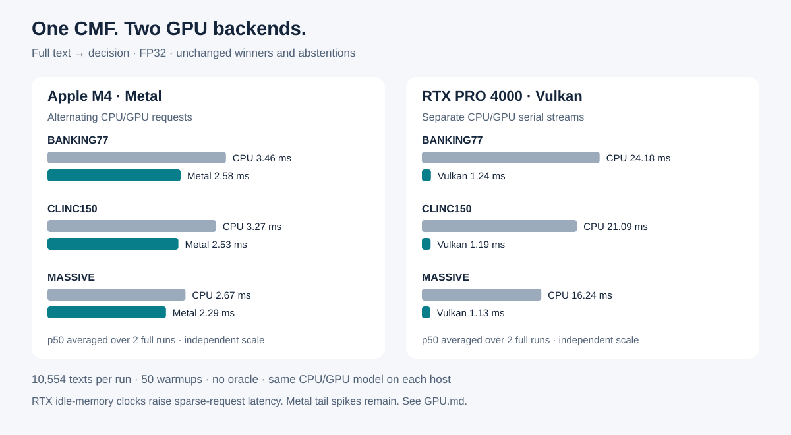

English: [README.md](README.md) · 中文: [README.zh.md](README.zh.md)

# CMF — Cortiq Model Format

CMF — проверяемый контейнер моделей: один файл может хранить веса, токенизатор,
метаданные чата, маски задач и накладки навыков для инференса без тяжёлого
ML-фреймворка.

[](https://github.com/infosave2007/cmf/actions/workflows/ci.yml)
[](https://crates.io/crates/cortiq-core)
[](https://docs.rs/cortiq-core)
[](LICENSE)

## CMF против других форматов

Таблица оценивает по 100-балльной шкале формат файла и его эталонный рантайм.
Каждому критерию дана оценка от 0 до 100 и вес. Веса выбраны нами и указаны в
таблице, так что итог легко пересчитать под свои задачи. Размер экосистемы
(сколько моделей уже выложено, сколько сторонних инструментов есть) — свойство
не файла, поэтому он не оценивается.

| критерий | вес | CMF | GGUF | safetensors | ONNX | MLX | EXL3 | PyTorch `.pt` |
|---|---:|---:|---:|---:|---:|---:|---:|---:|
| **Диапазон квантования**: кодировки, определённые самим форматом, от 16 бит до меньше 1 бита | 15 | **100** | 90 | 30 | 50 | 60 | 70 | 25 |
| **Разные кванты в одном файле**: любой кодек на любом тензоре, переквантование на месте | 10 | **100** | 90 | 50 | 60 | 70 | 75 | 30 |
| **Пустые веса не занимают места**: вырезанные нейроны и эксперты не хранятся, у каждого слоя своя ширина | 15 | **100** | 45 | 30 | 60 | 25 | 25 | 30 |
| **Гибкость, много задач на одной базе**: маски задач, навыки и маршрутизация экспертов в одном файле | 15 | **100** | 40 | 35 | 20 | 30 | 20 | 35 |
| **Самодостаточный файл**: токенизатор, шаблон чата, многокомпонентные конвейеры | 10 | **100** | 80 | 30 | 45 | 30 | 25 | 25 |
| **Целостность и подлинность**: хеши содержимого, проверка, подпись | 10 | **100** | 30 | 55 | 35 | 50 | 50 | 10 |
| **Загрузка без копирования**: mmap, GPU читает отображённый файл, эксперты по требованию | 10 | **100** | 90 | 85 | 40 | 80 | 60 | 40 |
| **Безопасное развитие**: старый читатель отказывается от того, что не умеет исполнять | 5 | **100** | 70 | 60 | 85 | 50 | 40 | 40 |
| **Автономный рантайм**: без Python и ML-фреймворка, CPU и GPU | 10 | 90 | **100** | 30 | 70 | 50 | 15 | 0 |
| **Взвешенный итог** | **100** | **99** | 69 | 42 | 49 | 48 | 42 | 26 |

На чём основана колонка CMF:

- **17 кодировок весов в одном каталоге тензоров.**
  - С плавающей точкой: f32, f16, bf16.
  - 8 бит: `q8_row` и `q8_2f` с масштабами по строкам и столбцам.
  - 4 бита: `q4_block`, `q4t`, `q4tp` (предсказанные масштабы, 4.17 бита на вес) и `mxfp4` (перепаковывает чекпойнты OCP MXFP4 без потерь).
  - Переменная ширина 3–8 бит: `vbit` и `vbit_ro`.
  - 2 бита: `q2tp`.
  - Тернарная: `q1t`.
  - Бинарные: `q1`, `q1g` (1.125 бита на вес) и `q1s` (бинарная плюс выбросы).
  - Меньше 1 бита на вес: бинарная низкоранговая `blr`.
- **Любой кодек на любом тензоре.** У каждой записи каталога свой тип.
  `--tensor-quant ШАБЛОН=КОДЕК` выбирает кодеки при конвертации. `cortiq requant`
  меняет их в готовом файле без возврата к исходному чекпойнту.
- **Пустые веса не занимают места.** Вырезанный нейрон FFN или эксперт MoE не
  хранится и не вычисляется. У каждого слоя своя ширина и своё число экспертов:
  читатель берёт размеры из форм тензоров, а не из одного общего числа
  ([спецификация §11](docs/CMF_V2_SPEC.ru.md)). Эксперты и навыки, которые
  текущая задача не использует, с диска не читаются.
- **Много задач на одной базе.**
  - Маска задачи стоит 1 бит на нейрон FFN, голову внимания, слой и эксперта.
  - Навыки — тензоры-замены в том же файле; память они занимают только при использовании.
  - Навык можно поставлять и отдельным маленьким файлом, привязанным к базе по хешу.
- **Один файл, в том числе для конвейеров.** Токенизатор и шаблон чата хранятся
  в файле. Модели редактирования изображений (трансформер, текстовый энкодер,
  VAE и планировщик), видео- и речевые модели — тоже по одному файлу.
- **Целостность.** У каждого тензора и каждой секции есть хеш. `cortiq verify`
  проверяет всю цепочку, а необязательную подпись Ed25519 ставит `cortiq sign`.
  Повреждённый файл отказывается открываться, а не выдаёт мусор.
- **Загрузка.**
  - Веса выровнены по страницам, тензоры — по 64 байта, файл отображается в память.
  - На Apple silicon GPU читает тензоры прямо из отображения, без копии.
  - Эксперты MoE подгружаются, когда их выбирает роутер.
- **Безопасное развитие.** Каждая новая возможность получает обязательный бит.
  Читатель, который не знает бита, отказывается от файла, а не угадывает.
- **Рантайм.** Написан на Rust без Python, работает на CPU, Metal и Vulkan/DX12.
  Есть и отдельный читатель на Python (stdlib + numpy). Файлы GGUF конвертируются
  напрямую командой `cortiq import-gguf`. В последней строке у CMF 90, а не 100,
  потому что у llama.cpp есть ещё бэкенды CUDA, ROCm и SYCL.

Критерии и обоснование оценок остальных форматов — в
[docs/COMPARISON.ru.md](docs/COMPARISON.ru.md).

## Решения на Metal и Vulkan

**Cortiq 0.8.0:** один CMF-файл с навыками, локальные решения по ошибке
реконструкции — без генерации токенов. CPU по умолчанию; GPU включается через
`CORTIQ_DECISION_DEVICE=metal` или `vulkan`. Обычная установка из crates.io
включает GPU-поддержку (Rust 1.88+).



[Запуск, свои навыки и API](docs/decision/hf/README_RU.md) ·
[Замеры и ограничения](docs/decision/hf/GPU.md)

## Состояние

CMF v2 — текущий формат на диске. Читатели проверяют конверт, границы секций,
метаданные тензоров и хэши; несовместимые изменения требуют бита возможностей
или смены версии. API Rust-крейтов пока до 1.0 и может меняться.

Проект пригоден для локального инференса и экспериментов с форматом. Цифры
качества и скорости зависят от модели и стенда; методика измерений находится в
тематических руководствах.

## Быстрый старт

Установите CLI и сконвертируйте небольшой открытый чекпоинт:

```sh
cargo install cortiq-cli --locked
cortiq convert --model Qwen/Qwen3-0.6B --quant q8 --output qwen.cmf
cortiq run qwen.cmf --prompt "Столица Франции?" --greedy --no-think
```

Для GGUF:

```sh
cortiq import-gguf model.gguf --output model.cmf
cortiq verify model.cmf
```

Сервер с OpenAI-совместимым API (чат и completions, с потоком и без, веб-панель на том же порту;
`--host 127.0.0.1` оставляет его локальным):

```sh
cortiq serve model.cmf --port 8080
curl http://localhost:8080/v1/chat/completions -H "Content-Type: application/json" \
  -d '{"model": "cmf", "messages": [{"role": "user", "content": "Привет"}]}'
```

## Dory Turbo с постоянным потолком на CUDA (0.8.72)

Турбо-файл [Nemotron Labs Dory 1.0 4B](https://huggingface.co/infosave/Nemotron-Labs-Dory1.0-4B-cmf) теперь держит
постоянный потолок памяти и на CUDA, вместе с промптом: на RTX 2000 Ada с 16 ГБ карта занята на 3,8 ГБ от 16 000 до
64 000 токенов, а в 0.8.71 доходило до 7,5 ГБ. Промпт после первых 8 192 строк читается через дальнее поле кусками,
поэтому 64 000 токенов доходят до первого токена за 33 с против 69 в 0.8.71 и 306 через Vulkan. Декод остаётся
80 tok/s, а факты в 100 000 символов находятся 8 раз из 8.

```sh
cargo install cortiq-cli --features cuda
CMF_GPU=cuda cortiq run dory-turbo.cmf --prompt-file report.txt --greedy --no-think
CMF_GPU=cuda CMF_MAX_SEQ=131072 cortiq serve dory-turbo.cmf --port 8080 --host 127.0.0.1   # API, совместимый с OpenAI
```

См. [docs/CUDA.ru.md](docs/CUDA.ru.md#dory-на-карте-16-гб); сервер описан в [docs/DORY.ru.md](docs/DORY.ru.md#сервер).

## Qwen3.8-27B Turbo на карте 16 ГБ через CUDA (0.8.71)

[Qwen3.8-27B Turbo](https://huggingface.co/infosave/Qwen3.8-27B-Turbo-cmf) теперь держит на CUDA постоянный потолок
памяти вместе с промптом: на RTX 2000 Ada с 16 ГБ весь прогон укладывается в 15,0 ГБ от 1 000 до 64 000 токенов.
Промпт после первых строк читается через дальнее поле кусками, как через Vulkan, а суммы дальнего поля строятся на
карте. На той же карте промпт в 64 000 токенов доходит до первого токена за 175 с против 278 через Vulkan, а
пересказ 100 000 символов декодируется на 31,5 tok/s против 21,3. Обычный файл на 16 000 токенов в эту карту не
помещается.

```sh
cargo install cortiq-cli --features cuda
CMF_GPU=cuda cortiq run qwen38-27b-turbo.cmf --prompt-file report.txt --greedy --no-think
```

См. [docs/CUDA.ru.md](docs/CUDA.ru.md#турбо-на-карте-16-гб).

## Dory и Qwen3.8-27B Turbo на CUDA (0.8.70)

Бэкенд CUDA запускает [Nemotron Labs Dory 1.0 4B](https://huggingface.co/infosave/Nemotron-Labs-Dory1.0-4B-cmf),
зацикленный nGPT, вместе с турбо-файлом: на RTX 3090 турбо-файл отвечает на 201 tok/s против 121 через Vulkan на
той же карте и читает 64 000 токенов за 33 с против 163. [Qwen3.8-27B
Turbo](https://huggingface.co/infosave/Qwen3.8-27B-Turbo-cmf) теперь пишет черновики и после печати на CUDA:
пересказ 100 000 символов декодируется на 80 tok/s против 42, текст тот же.

```sh
cargo install cortiq-cli --features cuda
CMF_GPU=cuda cortiq run dory-turbo.cmf --prompt "Напиши функцию на Rust, которая разворачивает список." --no-think
```

См. [docs/CUDA.ru.md](docs/CUDA.ru.md).

## Qwen3.8-27B на CUDA: чат 120–128 tok/s на RTX 3090 (0.8.69)

Бэкенд CUDA запускает гибриды семейства Qwen3.5 (миксеры GDN и внимание с гейтом) вместе с черновиками и их
проверкой на карте. На RTX 3090 [Qwen3.8-27B](https://huggingface.co/infosave/Qwen3.8-27B-cmf) в четырёх битах
генерирует чат на 120,2 tok/s со своей MTP-головой и на 128,4 с драфтером DFlash 2 рядом (57,7 через Vulkan), без
черновиков — 49,1 (40,8), а промпт в 4 000 токенов читает на 983 tok/s (560). Текст с черновиками совпадает с
текстом без них. Следующий ход чата читает только новое сообщение. Так же работают
[Arete-27B Turbo](https://huggingface.co/infosave/Arete-27B-Turbo-cmf) (без MTP-головы: DFlash поднимает код с 49
до 102 tok/s) и [OrcaCyber-Nano-1.0 Turbo](https://huggingface.co/infosave/OrcaCyber-Nano-1.0-Turbo-cmf), у каждой
свой драфтер на Hugging Face. Стек Fast Code тоже работает на CUDA.

```sh
cargo install cortiq-cli --features cuda
hf download infosave/Qwen3.8-27B-cmf qwen38-27b-q4tp.cmf qwen38-27b-q4tp.dflash.cmf --local-dir .
CMF_GPU=cuda CMF_DFLASH=1 cortiq serve qwen38-27b-q4tp.cmf --port 8080 --host 127.0.0.1
```

См. [docs/CUDA.ru.md](docs/CUDA.ru.md).

## Бэкенд CUDA для карт NVIDIA (0.8.67)

Нативный бэкенд CUDA рядом с wgpu и Metal, экспериментальный и по умолчанию выключенный: сборка с
`--features cuda`, выбор через `CMF_GPU=cuda`. Ничего не линкуется: ядра написаны на CUDA C и компилируются
при первом запуске, промпт считает cuBLAS. Покрыты плотные стеки с вниманием класса Spark-X2.x, включая
дальнее поле турбо-файла. [Spark-X2.6-4B Turbo](https://huggingface.co/infosave/Spark-X2.6-4B-turbo-CUDA-cmf)
в четырёх битах на NVIDIA A40 читает промпт в 4 000 токенов на 6096 tok/s и генерирует 111,5 tok/s (3789 и
80,2 через Vulkan); после промпта в 64 000 токенов первый токен приходит через 42,3 с, генерация 100,7 tok/s
в 3,9 ГБ карты (60,3 с и 85,9 tok/s через Vulkan):

```sh
cargo install cortiq-cli --features cuda
CMF_GPU=cuda CMF_MAX_SEQ=131072 cortiq serve spark-x2.6-4b-q4tp-turbo.cmf --port 8080 --host 127.0.0.1
```

См. [docs/CUDA.ru.md](docs/CUDA.ru.md).

## Ripple-65B Preview, плотная 65B в трёх файлах (0.8.60)

[Ripple-65B Preview](https://huggingface.co/infosave/Ripple-65B-Preview-cmf) в четырёх битах (34,6 ГБ), двух
(29,2 ГБ) и восьми (64,8 ГБ), каждый файл с турбо-заголовком: на NVIDIA A40 (46 ГБ) четырёхбитный файл декодирует
12 ток/с от 4 000 до 64 000 токенов промпта при 35–37 ГБ. На RTX PRO 6000 он декодирует 29,8 ток/с (23,4 до этого
релиза), восьмибитный читает промпт на 156 ток/с против 43:

```sh
cortiq run ripple-65b-q4tp.cmf --prompt-file report.txt --greedy
```

Рядом лежит драфтер DFlash 2 (`CMF_DFLASH=1`), его блок — одна отправка на карту: код 30,2 → 46,6 tok/s на
RTX PRO 6000, проза примерно вровень. См. [карточку](docs/hf/Ripple-65B-Preview-cmf.md).

## Qwen3.8-27B Turbo, черновики на Маке и в чате (0.8.59)

На MacBook Air M4 (24 ГБ, без вентилятора, шина памяти базового M4)
[турбо-файл](https://huggingface.co/infosave/Qwen3.8-27B-Turbo-cmf) декодирует 6,4 ток/с; с черновиками — от 10
до 20, а Neural Engine (`CMF_ANE=1`) читает промпт в 3 600 токенов за 28 с вместо 74. Оба переключателя по умолчанию
выключены:

```sh
CMF_GRAPH_SPEC=1 cortiq run qwen38-27b-turbo.cmf --prompt-file report.txt --greedy --no-think
```

На Vulkan глубина цепочки черновиков следует тому, сколько стоит раунд на самой карте: чат на карте 16 ГБ идёт на
29,8 ток/с вместо 26,5. Подробнее в [руководстве](docs/QWEN38_TURBO.ru.md).

## Qwen3.8-27B Turbo, постоянный потолок на карте (0.8.58)

[Турбо-файл](https://huggingface.co/infosave/Qwen3.8-27B-Turbo-cmf) держит память карты на месте при длинных
промптах, а строки длинного промпта по мере чтения уходят в RAM или на быстрый SSD. Файл помещается на карту 16 ГБ при
любой длине промпта. На RTX 5090 на 64 000 токенов: 15,7 ГБ против 22,8 ГБ, первый токен 177 с против 316 с, декод 92
ток/с против 51, а пароли и коды в тексте остаются точными:

```sh
cortiq run qwen38-27b-turbo.cmf --prompt-file report.txt --greedy --no-think --o1-spill /mnt/ssd/cortiq
```

Подробнее в [руководстве](docs/QWEN38_TURBO.ru.md).

## Nemotron-Labs Dory 1.0 4B, циклический трансформер (0.8.57)

[Dory](https://huggingface.co/infosave/Nemotron-Labs-Dory1.0-4B-cmf) проходит блоком из 40 подслоёв
несколько раз по одним и тем же весам. Турбо-файл на 2,09 ГБ выбирает один проход или два для каждого
токена резонансным роутером, держит длинный промпт в 0,5 ГБ памяти устройства и сохраняет пароли и коды
точными, выбирая их по работе самих слоёв. NVIDIA L4 декодирует 61 ток/с на реальных запросах и 54 ток/с
при контексте 64 000 токенов, MacBook Air M4 — 33 и 29 при 16 000:

```sh
cortiq run dory-turbo.cmf --prompt "Напиши функцию на Rust, которая разворачивает список." --no-think
```

См. [руководство](docs/DORY.ru.md).

## Kandinsky S2V 1.0 Pro-distill: из речи в видео (0.8.55)

[Kandinsky S2V](https://huggingface.co/infosave/Kandinsky-S2V-1.0-Pro-distill-cmf)
превращает опорный кадр и дорожку речи в видео с аватаром, где движется вся фигура. В одном
файле на 24 ГБ лежат DiT на 21B, энкодеры речи и текста, CLIP и VAE. L40S рендерит 5 с видео
512×512 за 5.6 минуты при 16.2 ГБ видеопамяти, MacBook Air M4 — за 4.45 часа при 14.6 ГБ
общей памяти:

```sh
cortiq s2v --model kandinsky-s2v-pro-q4tp.cmf --image reference.png --audio speech.wav --out avatar.avi
```

Подробнее в [руководстве](docs/KANDINSKY_S2V.ru.md).

## Unlimited-OCR-2 и MiniCPM-OCR-1.0 (0.8.54)

Две OCR-модели. [Unlimited-OCR-2](https://huggingface.co/infosave/Unlimited-OCR-2-cmf)
разбирает весь документ за один проход: её внимание читает не больше 512 токенов на
шаг при любой длине документа. RTX PRO 4500 декодирует 320 ток/с на всех 24 страницах,
10-ядерный M4 — 95–112. [MiniCPM-OCR-1.0](https://huggingface.co/infosave/MiniCPM-OCR-1.0-cmf)
распознаёт страницу или область на 254–267 ток/с, на M4 на 73–102:

```sh
cortiq run unlimited-ocr-2-q8_2f.cmf --image page1.png --image page2.png --prompt "Multi page parsing." --max-tokens 8192
cortiq run minicpm-ocr-1.0-q8_2f.cmf --image page.png --prompt "Text Recognition:" --max-tokens 2048
```

## Embryo-56M, маленькая модель в собственной архитектуре (0.8.53)

В [Embryo-56M](https://huggingface.co/infosave/Embryo-56M-cmf) 56 миллионов
параметров, модель рождена и обучена с нуля на GPU одного ноутбука, без чужих
весов: дельта-миксеры с затвором и два ограниченных якоря, 10,1 МБ состояния при
любой длине контекста, файл q8_2f на 91 МБ. Факты она отвечает дословно из записей,
которые выбирает роутер по ошибке реконструкции, понимает уточнения и отказывается
отвечать на вопрос о факте, если записи нет. Вне записей это очень маленькая модель:
грамматично, коротко, часто пусто.

| ток/с | декодирование | после 2000 токенов | префилл |
|---|---|---|---|
| GPU Apple M4 | 650 | 535 | 820 |
| CPU Apple M4 | 470 | 379 | 430 |
| RTX 2000 Ada | 925 | 796 | 1230 |
| EPYC 7443P | 612 | 405 | 233 |

Это первый экспериментальный вариант модели, полностью основанной на технологиях
Олега Кириченко. В дальнейшем выйдут более крупные модели для различных задач и
механизмы обучения моделей.

Как она собрана и что измеряет каждая проверка: [docs/EMBRYO_CHAT.ru.md](docs/EMBRYO_CHAT.ru.md).

## Clover-35B-A3B-Preview декодирует каузально (0.8.52)

Блочная диффузионная модель теперь по умолчанию идёт обычным каузальным путём
со штрафами из релиза: `q4tp-v2` даёт 120 ток/с на RTX 5090 и на прозе, и на
коде, 53 при бюджете 16 ГБ, 13–18 на Mac mini M4 (24 ГБ; промпт на Metal,
~170 ток/с, строки на CPU). `CMF_CLOVER_MODE=denoise` оставляет блочный денойзинг
LowConfidence, а `CMF_CLOVER_MODE=draft` включает самоспекуляцию вендора; все три
сравниваются в [docs/CLOVER.md](docs/CLOVER.md).

## SenseNova-Loop, Mage-VL-Cowork и Primal VAE (0.8.51)

[SenseNova-Loop-9B-Preview](https://huggingface.co/infosave/SenseNova-Loop-9B-Preview-cmf)
выполняет блок из 24 слоёв декодера дважды с общими весами, внутри петли — два
остаточных потока mHC; [Mage-VL-Cowork](https://huggingface.co/infosave/Mage-VL-Cowork-cmf) —
агент Microsoft на 4 млрд для работы с компьютером по скриншотам в исходном
разрешении; [Primal VAE](https://huggingface.co/infosave/primal_vae-cmf) —
автоэнкодер изображений Ostris (1–2 канала, сжатие 2×):

```sh
cortiq run sensenova-loop-9b-q4tp.cmf --image photo.jpg --prompt "Опиши это изображение." --no-think
cortiq run mage-vl-cowork-q8_2f.cmf --image screen.png --prompt "Task: open the Downloads folder."
cortiq vae --model primal_vae_2x2.cmf --mode roundtrip --input photo.png --output recon.png
```

Жадный текст и строки энкодеров совпадают с Transformers float32. Обе
визуальные башни считаются на GPU (Vulkan и Metal), петля и mHC — внутри
токен-графов wgpu и Metal; VAE кодирует или декодирует 1024×1024 одной
отправкой на GPU (0.40 / 0.29 с на NVIDIA A40).

## Речь LFM3, Omni и d1 (0.8.50)

[LFM3-Audio-2B](https://huggingface.co/infosave/LFM3-Audio-2B-cmf) распознаёт и
синтезирует речь (19 языков, голосовой чат с текстом и речью вперемешку),
[LFM3-Omni-2B](https://huggingface.co/infosave/LFM3-Omni-2B-cmf) добавляет
изображения и видео, а модели решений
[d1-2B](https://huggingface.co/infosave/d1-2B-cmf) и
[d1-Omni-2B](https://huggingface.co/infosave/d1-Omni-2B-cmf) отвечают на
именованные вопросы о состоянии за один прямой проход:

```sh
cortiq run lfm3-audio-2b-q8_2f.cmf --system "Perform ASR in English." --audio clip.wav --prompt ""
cortiq run lfm3-audio-2b-q8_2f.cmf --system "Perform TTS in American English using a female voice." \
  --prompt "Hello! How are you today?" --speech-out hello.wav
cortiq system-one d1-2b-q8_2f.cmf --state "Мне дважды списали деньги, посылка не пришла." \
  --questions '{"refund": {"type": "noul", "instructions": "Это запрос на возврат?"}}'
```

Распознавание совпадает с Transformers дословно, файл f16 воспроизводит кадры
речи точно; кодек лежит внутри файла. Весь проход d1 идёт одной отправкой на
GPU: один вопрос — около 45 мс на NVIDIA A40 и 79 мс на Apple M4. На Apple
silicon граф токена Metal теперь берёт короткие свёртки LFM3: LFM3-1.7B q4tp
генерирует на M4 84 ток/с (было 61).

## Liquid AI LFM3 (0.8.49)

[LFM3-1.7B](https://huggingface.co/infosave/LFM3-1.7B-cmf) — трёхгибридная
модель Liquid AI для локальных агентов и вызова инструментов (короткие свёртки,
полное внимание и внимание со скользящим окном, контекст 262k), её
предобученная [Base](https://huggingface.co/infosave/LFM3-1.7B-Base-cmf) и
визуально-языковая [LFM3-VL-2B](https://huggingface.co/infosave/LFM3-VL-2B-cmf)
(изображения и видео):

```sh
hf download infosave/LFM3-1.7B-cmf lfm3-1.7b-q8_2f.cmf --local-dir .
cortiq run lfm3-1.7b-q8_2f.cmf --prompt "Напиши функцию на Python, которая сливает два отсортированных списка." --max-tokens 2048
cortiq run lfm3-vl-2b-q8_2f.cmf --image photo.jpg --prompt "Опиши это изображение." --max-tokens 1024
```

Конвертация совпадает с Transformers float32 по каждой позиции. На NVIDIA A40
8-битный файл генерирует 166 ток/с, 4-битный — 231 ток/с; промпт в 4096 токенов
читается со скоростью ~600 ток/с. Тот же релиз передаёт шаблонам чата
`bos_token`, которого не хватало промптам LFM2/LFM2.5/LFM3.

## Apex-35B-V1.0 и ускорение графов Qwen3.5-MoE (0.8.48)

[Apex-35B-V1.0](https://huggingface.co/infosave/Apex-35B-V1.0-cmf) — агентное
дообучение Qwen3.6-35B-A3B с вызовом инструментов и рассуждениями по
необходимости:

```sh
hf download infosave/Apex-35B-V1.0-cmf apex-35b-v1.0-q4tp-v2.cmf --local-dir .
cortiq run apex-35b-v1.0-q4tp-v2.cmf --prompt "Напиши функцию на Python, которая сливает два отсортированных списка." --max-tokens 4096
```

На NVIDIA A40 4-битный файл генерирует 80 ток/с и читает промпт в 4096 токенов
со скоростью ~390 ток/с (первый токен через 10.5 с). Тот же релиз ускоряет все
стеки Qwen3.5/3.6-MoE на Vulkan: промпт q4tp-MoE читается чанками по 256 строк,
спекуляция выключена там, где MoE-черновик работал бы на CPU, а граф токена
собирает банк экспертов слоя один раз, а не на каждом токене (Apex q4tp-v2:
генерация 52.9 → 80.3 ток/с, промпт 4096 токенов 172 → 390 ток/с против 0.8.45).

## Spark-X2.6 на Mac (0.8.43–0.8.44)

[Spark-X2.6-4B](https://huggingface.co/infosave/Spark-X2.6-4B-cmf) на Mac mini
M4 (24 ГБ): файл по умолчанию q8_2f обрабатывает промпт в 1000 токенов на ~205
ток/с и генерирует 16–19 ток/с; файл q4tp генерирует ~30 ток/с. Ход чата через
`cortiq serve` считает только то, что изменилось с прошлого хода (история 2.3k
токенов: 0.6 с вместо 11 с). Замеры и отвергнутые варианты —
[docs/SPARK26_METAL.md](docs/SPARK26_METAL.md).

Intel-мак с Radeon Pro запускает ту же модель на своей видеокарте через
wgpu: `CMF_GPU=wgpu cortiq run ...` (нативному Metal-пути нужна общая память,
и там он уходит на CPU). Spark-X2.6-4B q4tp на Radeon Pro 560X генерирует
~16 ток/с против ~10 на i9 того же мака (0.8.44).

## Диффузионные модели по блокам (0.8.40)

[Clover-35B-A3B-Preview](https://huggingface.co/infosave/Clover-35B-A3B-Preview-cmf)
пишет ответ блоками по 32 токена и раскрывает по нескольку токенов за проход
денойзинга, а не по одному за шаг:

```sh
hf download infosave/Clover-35B-A3B-Preview-cmf clover-35b-a3b-preview-q4tp-v2.cmf --local-dir .
cortiq run clover-35b-a3b-preview-q4tp-v2.cmf --prompt "Объясни, как работает хеш-таблица." --no-think
```

С `CMF_CLOVER_MODE=denoise` на Vulkan каждый проход денойзинга — одна отправка на GPU (34 мс на блок из
32 токенов на RTX 5090: ~26 ток/с на прозе, 80–95 на коде при пороге из
релиза модели); на Apple silicon проходы идут на Metal (Mac mini M4, 24 ГБ:
3.2 ток/с на прозе, 6.5–9 на коде). Конвертация, параметры генерации и замеры —
[docs/CLOVER.md](docs/CLOVER.md). В этом же релизе графы всех MoE-моделей на
Vulkan занимают меньше видеопамяти: стек 35B-A3B q4tp — 18.8 ГБ вместо 31.8 ГБ,
а опубликованная Qwen3.6-35B-A3B декодирует 156 ток/с на карте 32 ГБ.

## Сжатие модели под задачу одной командой (0.8.39)

Общая модель превращается в специалиста под ваши промпты:

```sh
cortiq compress model.cmf prompts.jsonl model-task.cmf --ratio 0.9
```

Учитель отвечает на промпты: сама модель, другой `.cmf` или любая модель за
OpenAI-совместимым API (`--teacher openrouter:qwen/qwen3.8-27b`,
`openai:MODEL`, `api:MODEL --api-base URL`). Нейроны FFN, которые задача не
использует, уходят из модели: по засветке активаций или по обученной маске
DTG-MA (`--select dtgma`). Их вклад переносится в оставшиеся решением в
замкнутой форме, затем модель долечивается на ответах. Отложенные ответы
оценивают результат, и ворота качества решают, писать ли файл. У MoE-моделей
уходят эксперты, которых задача не выбирает. Итог остаётся в кодеке
исходника, квантование — отдельный шаг. GPU-стадии работают на NVIDIA (Vulkan)
и на Apple Silicon (Metal), с 0.8.42 — и сама свёртка: слой Qwen3.8-27B
сворачивается за 12 с на Mac mini M4 вместо ~11 мин на его CPU, а с
`--keep-grams` несколько целевых размеров сворачиваются из одной засветки.
Подробности — в [руководстве](docs/COMPRESS.ru.md); метод и замеры — в
[статье о сжатии под задачу](docs/research/TASK_COMPRESSION_ARTICLE.ru.md),
полный прогон на большой модели — в
[Qwen3.8-27B → 14B шаг за шагом](docs/research/QWEN38_27B_TASK_COMPRESSION.ru.md)
(готовая модель, её промпты и датасет учителя:
[infosave/Qwen3.8-27B-Code-14B-Experimental-cmf](https://huggingface.co/infosave/Qwen3.8-27B-Code-14B-Experimental-cmf)).

## Компактация MTP draft по своим промптам (0.8.38)

Для CMF с уже поддерживаемым dense MTP draft одна команда создаёт более узкий
draft, откалиброванный по типичным запросам задачи:

```sh
cortiq compact source.cmf prompts.jsonl task-model.cmf
```

Source используется как teacher; команда создаёт или переиспользует
`task-model.tdata`, сохраняет проверяемый plan и публикует только runnable
CMF. Это физическая compaction MTP-draft, а не general fine-tuning: trunk
остается исходным, а greedy output контролируется verifier-ом. JSONL, safety
gates и проверка на Metal/Vulkan описаны в
[руководстве MTP](docs/MTP_COMPACTION.ru.md).

GGUF трансформера Qwen Image можно импортировать как отдельный CMF;
подробности упаковки приведены в руководстве Qwen Image. Для нативного
редактирования используйте готовый однофайловый bundle или сохраните
компоненты отдельно.

## Нативное редактирование Qwen Image

Сначала соберите bundle из `transformer.cmf`, `text_encoder.cmf`,
`vae.cmf` и `scheduler_config.json`:

```sh
cortiq imagine-pack --bundle qwen-image \
  --out qwen-image/qwen-image-edit-2509-q4tp.cmf
```

Bundle встраивает трансформер, текстовый и зрительный энкодер Qwen2.5-VL,
токенизатор, процессор, конфигурации, VAE и планировщик. Для запуска нужны
только bundle и входное изображение:

```sh
cortiq imagine qwen-image/qwen-image-edit-2509-q4tp.cmf \
  --image docs/media/fox-512.png \
  --prompt "Добавьте яркий синий вязаный шарф, сохранив лису, позу и снежный фон." \
  --height 1024 --width 1024 --steps 40 --cfg 4 --seed 7 \
  --reference-size 1024 --out fox-scarf.png
```

Для гибкой раскладки оставьте компоненты в одном каталоге или укажите их
явно:

```sh
cortiq imagine qwen-image/transformer.cmf \
  --text-encoder qwen-image/text_encoder.cmf \
  --vae qwen-image/vae.cmf \
  --scheduler qwen-image/scheduler_config.json \
  --image docs/media/fox-512.png \
  --prompt "Превратите сцену в акварельную иллюстрацию." \
  --height 1024 --width 1024 --steps 40 --cfg 4 --seed 7 \
  --reference-size 1024 --out watercolor.png
```

Нужна хотя бы одна ссылка `--image`; для нескольких изображений повторите
флаг. Профиль `--reference-size 1024` задаёт корень из площади входного VAE
1024² и не меняет размер результата.
На совместимом Vulkan-устройстве `cortiq imagine` автоматически выбирает
резидентный проход трансформера Qwen: скрытое состояние остаётся на устройстве
между блоками, а в конце каждого прохода выполняется одно чтение обратно.
Пути CPU и Metal остаются доступными, а проверка бюджета памяти выбирает
совместимый путь. Правила получения и упаковки с
фиксированными ревизиями приведены в [руководстве Qwen Image](docs/QWEN_IMAGE.md).

CLI также предоставляет `info`, `bench`, `ppl`, `serve`, `skill`, `moe-mask`,
`moe-defrag`, `requant`, `compact`, `sign`, `imagine`, `animate` и `ltx-video`.
Команда `cortiq <команда> --help` показывает флаги и ограничения.

### Транскрибация Whisper

Cortiq преобразует 128-бинные чекпоинты Whisper из Hugging Face (в том числе
large-v3 и large-v3-turbo) в CMF, а затем транскрибирует WAV без Python:

```sh
cortiq convert --model openai/whisper-large-v3-turbo --quant q4tp \
  --output whisper-large-v3-turbo-q4tp.cmf
cortiq verify whisper-large-v3-turbo-q4tp.cmf
cortiq transcribe whisper-large-v3-turbo-q4tp.cmf interview.wav --language ru
```

Смешанный профиль q4tp оставляет внимание и общую матрицу токенов/выхода
декодера в q8_2f, FFN-матрицы — в q4tp, позиционные embeddings — в f16.
Это не гарантия паритета или качества: перед внедрением измерьте WER на своих
языках и аудио. WAV PCM/float сводится к mono 16 кГц. При наличии используется
Metal/wgpu; `CMF_GPU=0` принудительно включает CPU. По умолчанию сохраняется
полный контекст 30 секунд; экспериментальный `CMF_WHISPER_TRIM_ENCODER=1`
может повлиять на качество распознавания.

### Nemotron 3.5 Transcribe (0.8.47)

`cortiq-cli` 0.8.47 целиком на Rust исполняет [NVIDIA Nemotron 3.5 Transcribe
30B-A4B](https://huggingface.co/nvidia/NVIDIA-Nemotron-3.5-Transcribe-30B-A4B):
мел-фронтенд, ASR-энкодер, диаризацию Sortformer с кэшем спикеров, декодер
Mamba-2/внимание/MoE и пословные таймкоды. Готовые файлы — на
[Hugging Face](https://huggingface.co/infosave/Nemotron-3.5-Transcribe-30B-A4B-cmf):

```sh
cortiq transcribe nemotron-3.5-transcribe-30b-a4b-q4tp.cmf встреча.wav
cortiq transcribe nemotron-3.5-transcribe-30b-a4b-q4tp.cmf встреча.wav --timestamps
cortiq transcribe nemotron-3.5-transcribe-30b-a4b-q4tp.cmf a.wav b.wav --stats
```

`--prompt` принимает инструкции модели (чистый текст, метки спикеров `<spk:N>`,
перевод). На GPU декодер работает резидентным кадром со спекулятивным декодом
слоем MTP; карта, на которую не помещаются все эксперты, держит самых
используемых, остальных считает CPU (`CMF_NEMO_EXPERT_GB` задаёт бюджет).
`cortiq convert --model <каталог чекпоинта>` упаковывает чекпоинт NeMo
(`--quant q8_2f | q4tp | q2tp`).

### Многоязычный TTS Phonon 40M (0.8.36)

Команды `phonon-pack` и `tts` добавляются в **cortiq-cli 0.8.36**. В уже
опубликованных 0.8.35 и более ранних крейтах этих команд нет. До появления
тега `v0.8.36` и публикации крейта 0.8.36 нельзя считать, что обычный
`cargo install cortiq-cli` их установит. После публикации релиза:

```sh
# Обычная установка включает GPU и мост Phonon.
cargo install cortiq-cli --version 0.8.36 --locked

# Либо переносимая CPU-сборка с сохранением поддержки Phonon.
cargo install cortiq-cli --version 0.8.36 --locked \
  --no-default-features --features phonon
```

После принятия условий исходной модели можно упаковать её локальную копию;
готовый CMF также скачивается через API-команду Hugging Face:

```sh
hf download gradium/phonon-40m-multilingual --local-dir phonon-source
cortiq phonon-pack phonon-source --output phonon-40m-multilingual-q8.cmf

hf download infosave/phonon-40m-multilingual-cmf \
  phonon-40m-multilingual-q8.cmf --local-dir .
cortiq verify phonon-40m-multilingual-q8.cmf
cortiq tts phonon-40m-multilingual-q8.cmf "Bonjour, monde." \
  --lang fr --temperature 0.3 --seed 4242424242424242 --out bonjour.wav
```

CMF побайтно хранит исходные Q8 GGUF, конфигурацию, токенизатор и latent
стандартного голоса; после проверки Cortiq материализует эти записи и вызывает
поддерживаемый Gradium рантайм `ptts`. Это мост, а не заявление о нативной
реализации Phonon. Модель принимает **только** `en`, `fr`, `de`, `es`, `pt`:
русский язык и автоопределение языка не поддерживаются; `--voice-file`
принимает только заранее вычисленный совместимый latent, а не запись голоса.
Исходные веса распространяются на условиях CC-BY-NC-4.0. Подробности и
происхождение — в [исходнике карточки](docs/hf/Phonon-40M-Multilingual-cmf.md);
работающий публичный тест доступен в
[Space](https://huggingface.co/spaces/infosave/phonon-40m-multilingual-cmf-demo).

## Что хранит файл CMF

- Фиксированный 128-байтовый конверт, адресующий все секции.
- JSON-заголовок с архитектурой, квантованием, метаданными чата и источником.
- Бинарный каталог тензоров с dtype, формой, смещениями, длинами и `hash64`.
- Выровненный по страницам блоб весов, который можно отобразить через mmap.
- Необязательные маски задач, накладки навыков, байты токенизатора и sparse-индекс.

`cortiq verify` завершается ошибкой при неверных границах или несовпадении хэша;
`python/cmf_reader.py` — небольшой независимый ридер для инспекции. Нормативная
[спецификация CMF v2](docs/CMF_V2_SPEC.ru.md) описывает раскладку.

## Квантование

Квантование выбирается для каждого тензора: чувствительные тензоры можно
оставить в высокой точности, а большие матрицы упаковать компактнее.

| Кодек | Назначение |
|---|---|
| `f16`, `f32` | нормы, эмбеддинги и точные управляющие тензоры |
| `q8`, `q8_2f` | высокая точность; `q8_2f` добавляет масштабы входных каналов |
| `q4`, `q4t`, `q4tp` | обычные плотные и MoE-веса |
| `q2tp`, `vbit`, `vbit_ro` | ограниченный размер или смешанные разрядности |
| `q1`, `q1t`, `q1s` | обученные бинарные или экспериментальные PTQ-пути |

Экспериментальный низкоразрядный путь описан в [Q1T/PTQ](docs/Q1T_PTQ.md), а
матрица поддержки кодеков — в [обзоре покрытия](docs/QUANT_COVERAGE.ru.md).

## Возможности рантайма

- **CPU:** переносимая реализация на Rust с mmap-весами.
- **GPU:** нативный Metal на macOS и wgpu (Vulkan/DX12), если это поддерживают
  сборка и устройство. Для запроса GPU задайте `CMF_GPU=1`.
- **Длинный контекст:** `--o1` использует состояние фиксированного размера и
  меняет рост памяти на измеряемую потерю качества; проверяйте свою модель.
- **Навыки:** один хребет хранит маски задач и накладки замещающих тензоров,
  не требуя второй полной копии модели для неактивного навыка.
- **MoE:** маска задачи и физическая дефрагментация могут уменьшить набор
  активных экспертов. Перед публикацией проверьте PPL на отложенных данных.
- **Спекуляция:** MTP и draft-пути включаются там, где метаданные и измеренная
  доля принятых токенов делают их полезными.
- **Сервер:** `cortiq serve` предоставляет локальный OpenAI-совместимый HTTP API.
- **Медиа:** `imagine`, `animate` и `ltx-video` запускают подходящие пайплайны
  изображений, видео и аудио.

## Платформы и семейства моделей

| Цель | Поддержка |
|---|---|
| Linux/macOS/Windows | CPU; GPU через доступный бэкенд wgpu |
| Apple Silicon | CPU и Metal; память общая с системой |
| NVIDIA/AMD | Vulkan или DX12 через wgpu там, где путь протестирован |
| Android/iOS | См. мобильный проект и руководство split |

Нативная конвертация охватывает Qwen, Llama, Mistral, Gemma, Phi, DeepSeek,
Kimi Linear, MiniCPM и несколько MoE/video-семейств. Ограничения и опубликованные
файлы собраны в [руководствах моделей](docs/hf/README.md). Для неподдержанного
чекпоинта попробуйте `import-gguf`; при отказе создайте воспроизводимый issue.

## Тематические документы

- [Спецификация CMF v2](docs/CMF_V2_SPEC.ru.md) — нормативная раскладка файла.
- [Сравнение форматов](docs/COMPARISON.ru.md) — критерии и источники измерений.
- [Навыки](docs/SKILLS.ru.md) — маски, накладки и маршрутизация.
- [Сжатие под задачу](docs/COMPRESS.ru.md) — руководство по `cortiq compress`;
  [статья о методе](docs/research/TASK_COMPRESSION_ARTICLE.ru.md) и
  [прогон Qwen3.8-27B → 14B](docs/research/QWEN38_27B_TASK_COMPRESSION.ru.md).
- [GPU-рецепты](docs/GPU_KERNEL_RECIPES.md) — измерения бэкендов.
- [Несколько GPU](docs/MULTI_GPU.md) и [разделение на мобильном](docs/MOBILE_SPLIT.ru.md).
- [FCD-восстановление](docs/RUST_FCD.md) и [низкоразрядный PTQ](docs/Q1T_PTQ.md).
- [Компактация MTP FFN](docs/MTP_COMPACTION.ru.md) — независимая калибровка и
  физическое уменьшение FFN у MTP-draft.
- [Qwen Image Edit](docs/QWEN_IMAGE.md) — однофайловое редактирование и
  отдельная раскладка компонентов.
- [Карточки моделей и конвертация](docs/hf/README.md).
- [Cortiq Spectra](docs/SPECTRA.ru.md) — детерминированная потоковая CPU-раскраска
  двухэнергетического рентгена, профили сканера, маска отказов и измеренные
  ограничения.

## Сборка из исходников

```sh
cargo build --release --workspace
cargo build --release -p cortiq-cli --no-default-features  # только CPU
cargo test --workspace
```

Рабочая область распространяется по Apache-2.0. Перед распространением или
сообщением об уязвимости прочтите [LICENSE](LICENSE), [PATENTS.md](PATENTS.md),
[CONTRIBUTING.md](CONTRIBUTING.md) и [SECURITY.md](SECURITY.md). Готовые сборки
и контрольные суммы публикуются на [странице релизов GitHub](https://github.com/infosave2007/cmf/releases).
