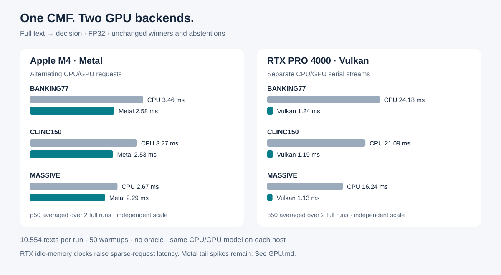

English: [README.md](README.md) · Русский: [README.ru.md](README.ru.md)

# CMF — Cortiq Model Format

CMF 是可审计的模型容器：一个文件可以保存权重、分词器、聊天元数据、任务掩码
和技能覆盖层，并在不依赖大型 ML 框架的情况下运行推理。

[](https://github.com/infosave2007/cmf/actions/workflows/ci.yml)
[](https://crates.io/crates/cortiq-core)
[](https://docs.rs/cortiq-core)
[](LICENSE)

## CMF 与其他格式对比

下表以百分制为文件格式及其参考运行时打分。每项标准得 0–100 分并有一个权重。
权重由我们设定并列在表中，你可以按自己的需求重新计算总分。生态规模（已发布多少
模型、有多少第三方工具）不是文件本身的属性，因此不计分。

| 标准 | 权重 | CMF | GGUF | safetensors | ONNX | MLX | EXL3 | PyTorch `.pt` |
|---|---:|---:|---:|---:|---:|---:|---:|---:|
| **量化范围**：格式本身定义的编码，从 16 位到低于 1 位 | 15 | **100** | 90 | 30 | 50 | 60 | 70 | 25 |
| **一个文件内混用量化**：任意张量用任意编码，原地重新量化 | 10 | **100** | 90 | 50 | 60 | 70 | 75 | 30 |
| **空权重不占空间**：剪掉的神经元和专家不存储，每层保留自己的宽度 | 15 | **100** | 45 | 30 | 60 | 25 | 25 | 30 |
| **灵活性，一个底座承载多个任务**：任务掩码、技能、专家路由都在一个文件里 | 15 | **100** | 40 | 35 | 20 | 30 | 20 | 35 |
| **自包含文件**：分词器、聊天模板、多组件流水线 | 10 | **100** | 80 | 30 | 45 | 30 | 25 | 25 |
| **完整性与真实性**：内容哈希、校验、签名 | 10 | **100** | 30 | 55 | 35 | 50 | 50 | 10 |
| **零拷贝、按需加载**：mmap，GPU 直接读取映射文件，专家按需调入 | 10 | **100** | 90 | 85 | 40 | 80 | 60 | 40 |
| **安全演进**：旧读取器拒绝它无法执行的文件 | 5 | **100** | 70 | 60 | 85 | 50 | 40 | 40 |
| **独立运行时**：不需要 Python 或 ML 框架，支持 CPU 和 GPU | 10 | 90 | **100** | 30 | 70 | 50 | 15 | 0 |
| **加权总分** | **100** | **99** | 69 | 42 | 49 | 48 | 42 | 26 |

CMF 一列的依据：

- **一个张量目录里有 17 种权重编码。**
  - 浮点：f32、f16、bf16。
  - 8 位：`q8_row`，以及带行、列双尺度的 `q8_2f`。
  - 4 位：`q4_block`、`q4t`、`q4tp`（预测尺度，每权重 4.17 位），以及 `mxfp4`（无损重打包 OCP MXFP4 检查点）。
  - 可变 3–8 位：`vbit` 和 `vbit_ro`。
  - 2 位：`q2tp`。
  - 三值：`q1t`。
  - 二值：`q1`、`q1g`（每权重 1.125 位）和 `q1s`（二值加离群值）。
  - 每权重低于 1 位：二值低秩 `blr`。
- **任意张量用任意编码。** 目录中每个条目都有自己的数据类型。转换时用
  `--tensor-quant 模式=编码` 选择编码。`cortiq requant` 可直接修改现有文件中的
  编码，无需回到原始检查点。
- **空权重不占空间。** 剪掉的 FFN 神经元或 MoE 专家既不存储也不计算。每层有自己
  的宽度和专家数，因为读取器从张量形状读取尺寸，而不是依赖一个全局数字
  （[规范 §11](docs/CMF_V2_SPEC.zh.md)）。当前任务用不到的专家和技能不会从磁盘读取。
- **一个底座承载多个任务。**
  - 任务掩码对每个 FFN 神经元、注意力头、层和专家各只占 1 位。
  - 技能是同一文件中的替换张量，只在使用时才占内存。
  - 技能也可以作为独立的小文件分发，通过哈希绑定到它的底座。
- **一个文件，流水线也不例外。** 分词器和聊天模板存放在文件内。图像编辑模型
  （Transformer、文本编码器、VAE 和调度器）、视频模型和语音模型也都是单个文件。
- **完整性。** 每个张量、每个段都有哈希。`cortiq verify` 校验整条链，可选的
  Ed25519 签名由 `cortiq sign` 生成。损坏的文件会拒绝打开，而不是输出垃圾。
- **加载。**
  - 权重按页对齐，张量按 64 字节对齐，文件通过内存映射读取。
  - 在 Apple silicon 上，GPU 直接从映射读取张量，不做拷贝。
  - MoE 专家在路由器选中时才调入。
- **安全演进。** 每项新能力都对应一个必需特性位。读取器遇到不认识的位会拒绝该
  文件，而不是去猜。
- **运行时。** 用 Rust 编写，不需要 Python，可在 CPU、Metal 和 Vulkan/DX12 上
  运行。另有一个独立的 Python 读取器（stdlib + numpy）。GGUF 文件可用
  `cortiq import-gguf` 直接转换。CMF 在最后一行得 90 分而不是 100 分，因为
  llama.cpp 还有 CUDA、ROCm 和 SYCL 后端。

各项标准以及其他格式得分的依据见
[docs/COMPARISON.zh.md](docs/COMPARISON.zh.md)。

## Metal 与 Vulkan 决策加速

**Cortiq 0.8.0：** 一个 CMF 文件封装可训练技能，通过重建误差在本地做出决策，
无需生成 token。默认使用 CPU；通过 `CORTIQ_DECISION_DEVICE=metal` 或 `vulkan`
选择 GPU。crates.io 默认安装已包含 GPU 支持（需要 Rust 1.88+）。



[快速入门、自定义技能与 API（英语）](docs/decision/hf/README.md) ·
[测试结果与限制（英语）](docs/decision/hf/GPU.md)

## 状态

CMF v2 是当前磁盘格式。读取器会检查信封、区段边界、张量元数据和哈希；不兼容
的改变必须增加特性位或版本号。Rust crate 的 API 尚未到 1.0，仍可能调整。

项目适合本地推理和格式实验。质量与速度数字取决于模型和测试平台；每项数据的
测量方法请见对应的专题文档。

## 快速开始

安装 CLI，并转换一个小型公开检查点：

```sh
cargo install cortiq-cli --locked
cortiq convert --model Qwen/Qwen3-0.6B --quant q8 --output qwen.cmf
cortiq run qwen.cmf --prompt "法国的首都是哪里？" --greedy --no-think
```

已有 GGUF 时直接导入：

```sh
cortiq import-gguf model.gguf --output model.cmf
cortiq verify model.cmf
```

作为 OpenAI 兼容 API 启动服务(聊天与 completions,流式或非流式,同一端口上有网页面板;`--host 127.0.0.1` 只在本机监听):

```sh
cortiq serve model.cmf --port 8080
curl http://localhost:8080/v1/chat/completions -H "Content-Type: application/json" \
  -d '{"model": "cmf", "messages": [{"role": "user", "content": "你好"}]}'
```

## MiniMax-H3-Turbo:支持 CUDA，Vulkan 与 Metal 更快(0.8.76)

[MiniMax-H3-Turbo](https://huggingface.co/infosave/MiniMax-H3-Turbo-cmf) 由一条提示词生成带同步音频的视频，现在与
MiniMax-H3-Image 一样，把 Transformer 作为一条常驻链放在 GPU 上运行。在 RTX A5000 上，512×288、39 帧、四步的片段在
CUDA 上用时 19.5 秒（之前 165.1 秒），Vulkan 上用时 25.8 秒（之前 97.2 秒）；显存限制在 4 GB 以内时 CUDA 用时
22.4 秒。MacBook Air M4 生成 512×256 用时 157 秒，之前是 183 秒。本版本还修复了 0.8.75 中 `cortiq animate`
在 24 GB 的 Vulkan 显卡上内存不足的问题:

```sh
cortiq animate mmh3-turbo-q4tp.cmf --prompt "A corgi in a chef hat flipping a pancake." --out corgi.avi
CMF_GPU=cuda CMF_GPU_VRAM_MB=4000 cortiq animate mmh3-turbo-q4tp.cmf --prompt "…" --out clip.avi
```

## MiniMax-H3-Image:Vulkan 与 Metal(0.8.75)

[MiniMax-H3-Image](https://huggingface.co/infosave/MiniMax-H3-Image-cmf) 现在在 Vulkan 和 Apple 芯片上也把图片
从 Transformer 的第一个块到最后一个块都留在 GPU 上，与之前的 CUDA 一样。在 RTX A5000 上，默认后端 Vulkan 生成
2048×2048 用时 33.7 秒，0.8.74 需要 260.1 秒（CUDA 为 24.8 秒）；编辑一张 1024×1024 的图片用时 30.6 秒，之前是
164.5 秒。`CMF_GPU_VRAM_MB` 在 Vulkan 上同样是显存上限：4 GB 以内生成 2048×2048 用时 46.8 秒，图片逐位相同。
24 GB 的 MacBook Air M4 生成 1024×1024 用时 138.8 秒，之前是 305.2 秒:

```sh
cortiq imagine minimax-h3-image-q4tp.cmf --prompt @prompt.txt --out out.png
CMF_GPU_VRAM_MB=8000 cortiq imagine minimax-h3-image-q4tp.cmf --prompt @prompt.txt --out out.png
```

参见[指南](docs/MINIMAX_H3_IMAGE.zh.md)。

## MiniMax-H3-Image:文生图与图片编辑(0.8.73)

[MiniMax-H3-Image](https://huggingface.co/infosave/MiniMax-H3-Image-cmf) 用六步生成和编辑 4 到 16 百万像素的
图片。一个 24.6 GB 的文件里有 4 位的 200 亿参数扩散 Transformer 和 Qwen3-VL 提示词编码器,以及 8 位的 VAE。
在 16 GB 的 RTX 2000 Ada 上,CUDA 后端生成 2048×2048 用时 50.3 秒;在 4 GB 显存上限下用时 60.2 秒,得到
同一张图片:

```sh
CMF_GPU=cuda cortiq imagine minimax-h3-image-q4tp.cmf --prompt @prompt.txt --out out.png
CMF_GPU=cuda cortiq imagine minimax-h3-image-q4tp.cmf --image photo.png --prompt @edit.txt --out edit.png
CMF_GPU=cuda CMF_GPU_VRAM_MB=4000 cortiq imagine minimax-h3-image-q4tp.cmf --prompt @prompt.txt --out out.png
```

参见[指南](docs/MINIMAX_H3_IMAGE.zh.md)。模型采用 MiniMax-H3-Image Community License。

## Dory Turbo 在 CUDA 上保持固定显存上限(0.8.72)

[Nemotron Labs Dory 1.0 4B](https://huggingface.co/infosave/Nemotron-Labs-Dory1.0-4B-cmf) 的 turbo 文件现在在 CUDA
上也连同提示一起保持固定的显存上限：在 16 GB 的 RTX 2000 Ada 上，从 16 000 到 64 000 个词元显卡都占 3.8 GB，而
0.8.71 会达到 7.5 GB。超过前 8 192 行的提示经远场分块读取，所以 64 000 个词元的提示 33 秒给出首个词元（0.8.71 为
69 秒，Vulkan 为 306 秒）。解码仍是 80 tok/s，插在 100 000 个字符里的事实 8 次都能找到。

```sh
cargo install cortiq-cli --features cuda
CMF_GPU=cuda cortiq run dory-turbo.cmf --prompt-file report.txt --greedy --no-think
CMF_GPU=cuda CMF_MAX_SEQ=131072 cortiq serve dory-turbo.cmf --port 8080 --host 127.0.0.1   # 兼容 OpenAI 的 API
```

见 [docs/CUDA.zh.md](docs/CUDA.zh.md#dory-在-16-gb-显卡上)；服务器见 [docs/DORY.zh.md](docs/DORY.zh.md#服务器)。

## 通过 CUDA 在 16 GB 显卡上运行 Qwen3.8-27B Turbo(0.8.71)

[Qwen3.8-27B Turbo](https://huggingface.co/infosave/Qwen3.8-27B-Turbo-cmf) 现在在 CUDA 上连同提示一起保持固定的
显存上限：在 16 GB 的 RTX 2000 Ada 上，从 1 000 到 64 000 个词元，整个运行都不超过 15.0 GB。超过最前几行的提示
经远场分块读取，与 Vulkan 相同，远场的累加在显卡上构建。同一块显卡上，64 000 个词元的提示在 175 秒后给出首个
词元（Vulkan 278 秒），概括 100 000 个字符时以 31.5 tok/s 解码（Vulkan 21.3）。普通文件在这块显卡上放不下
16 000 个词元。

```sh
cargo install cortiq-cli --features cuda
CMF_GPU=cuda cortiq run qwen38-27b-turbo.cmf --prompt-file report.txt --greedy --no-think
```

见 [docs/CUDA.zh.md](docs/CUDA.zh.md#16-gb-显卡上的-turbo)。

## CUDA 上的 Dory 和 Qwen3.8-27B Turbo(0.8.70)

CUDA 后端可以运行循环的 nGPT [Nemotron Labs Dory 1.0 4B](https://huggingface.co/infosave/Nemotron-Labs-Dory1.0-4B-cmf)，
包括它的 turbo 文件：在 RTX 3090 上 turbo 文件以 201 tok/s 回答（同一块显卡走 Vulkan 为 121），读 64 000 个词元
只需 33 秒（Vulkan 163 秒）。[Qwen3.8-27B Turbo](https://huggingface.co/infosave/Qwen3.8-27B-Turbo-cmf) 现在在
CUDA 上封口之后也用草稿：概括 100 000 个字符时以 80 tok/s 解码（之前 42），文本相同。

```sh
cargo install cortiq-cli --features cuda
CMF_GPU=cuda cortiq run dory-turbo.cmf --prompt "写一个反转列表的 Rust 函数。" --no-think
```

见 [docs/CUDA.zh.md](docs/CUDA.zh.md)。

## CUDA 上的 Qwen3.8-27B：RTX 3090 上聊天 120–128 tok/s(0.8.69)

CUDA 后端在显卡上运行 Qwen3.5 系列混合模型（GDN 混合层加门控注意力），草稿及其验证也在显卡上完成。在 RTX 3090
上，4 位的 [Qwen3.8-27B](https://huggingface.co/infosave/Qwen3.8-27B-cmf) 借助自带的 MTP 头以 120.2 tok/s 生成
聊天回答，配上 DFlash 2 草稿模型为 128.4（Vulkan 为 57.7），不用草稿为 49.1（40.8），以 983 tok/s 读入 4 000
词元的提示（560）。有草稿与无草稿的文本相同。聊天的下一轮只读取新消息。
[Arete-27B Turbo](https://huggingface.co/infosave/Arete-27B-Turbo-cmf)（没有 MTP 头：DFlash 把代码从 49 提到
102 tok/s）和 [OrcaCyber-Nano-1.0 Turbo](https://huggingface.co/infosave/OrcaCyber-Nano-1.0-Turbo-cmf) 同样可用，
各自的草稿模型都在 Hugging Face 上。Fast Code 堆栈也能在 CUDA 上运行。

```sh
cargo install cortiq-cli --features cuda
hf download infosave/Qwen3.8-27B-cmf qwen38-27b-q4tp.cmf qwen38-27b-q4tp.dflash.cmf --local-dir .
CMF_GPU=cuda CMF_DFLASH=1 cortiq serve qwen38-27b-q4tp.cmf --port 8080 --host 127.0.0.1
```

见 [docs/CUDA.zh.md](docs/CUDA.zh.md)。

## 面向 NVIDIA 显卡的 CUDA 后端(0.8.67)

在 wgpu 和 Metal 之外新增原生 CUDA 后端，属实验性质，默认关闭：用 `--features cuda` 构建，用 `CMF_GPU=cuda`
选择。不链接任何库：内核用 CUDA C 编写，首次使用时编译，提示由 cuBLAS 计算。它覆盖 Spark-X2.x 一类的稠密
注意力堆栈，包括 turbo 文件的远场。4 位的
[Spark-X2.6-4B Turbo](https://huggingface.co/infosave/Spark-X2.6-4B-turbo-CUDA-cmf) 在 NVIDIA A40 上以
6096 tok/s 读入 4 000 词元的提示，以 111.5 tok/s 生成（Vulkan 为 3789 和 80.2）；读完 64 000 词元的提示后，
42.3 秒给出首个词元，以 100.7 tok/s 生成，占显卡 3.9 GB（Vulkan 为 60.3 秒和 85.9 tok/s）：

```sh
cargo install cortiq-cli --features cuda
CMF_GPU=cuda CMF_MAX_SEQ=131072 cortiq serve spark-x2.6-4b-q4tp-turbo.cmf --port 8080 --host 127.0.0.1
```

见 [docs/CUDA.zh.md](docs/CUDA.zh.md)。

## Ripple-65B Preview:三个文件中的稠密 65B(0.8.60)

[Ripple-65B Preview](https://huggingface.co/infosave/Ripple-65B-Preview-cmf) 的四比特(34.6 GB)、二比特(29.2 GB)和八比特(64.8 GB)文件,每个都带 turbo 头:在 NVIDIA A40(46 GB)上,四比特文件从 4 000 到 64 000 个 token 的提示均以 12 tok/s 解码,占 35 到 37 GB。在 RTX PRO 6000 上解码 29.8 tok/s(本版之前为 23.4),八比特文件读取提示 156 tok/s,原来是 43:

```sh
cortiq run ripple-65b-q4tp.cmf --prompt-file report.txt --greedy
```

旁边附有 DFlash 2 草稿器(`CMF_DFLASH=1`),其草稿块作为一次显卡提交运行:在 RTX PRO 6000 上代码 30.2 → 46.6 tok/s,散文大致持平。见[模型卡](docs/hf/Ripple-65B-Preview-cmf.md)。

## Qwen3.8-27B Turbo:Mac 上和对话中的草稿(0.8.59)

在 MacBook Air M4(24 GB,无风扇,基础版 M4 的内存总线)上,[Turbo 文件](https://huggingface.co/infosave/Qwen3.8-27B-Turbo-cmf)解码 6.4 tok/s;开启草稿后为 10 到 20,Neural Engine(`CMF_ANE=1`)读取 3 600 个 token 的提示用 28 秒,原来是 74 秒。两个开关默认都关闭:

```sh
CMF_GRAPH_SPEC=1 cortiq run qwen38-27b-turbo.cmf --prompt-file report.txt --greedy --no-think
```

在 Vulkan 上,草稿链的深度按一轮在该显卡上的实际耗时调整:16 GB 显卡上的对话为 29.8 tok/s,原来是 26.5。见[指南](docs/QWEN38_TURBO.zh.md)。

## Qwen3.8-27B Turbo,显卡上的固定上限(0.8.58)

[Turbo 文件](https://huggingface.co/infosave/Qwen3.8-27B-Turbo-cmf)让长提示下的显存保持不变,长提示的行一读完就进入内存或高速 SSD。任何长度的提示都能放进 16 GB 显卡。RTX 5090 上 64 000 个 token 时:15.7 GB 对 22.8 GB,首个 token 177 秒对 316 秒,解码 92 tok/s 对 51,文本中的密码和编码依然精确:

```sh
cortiq run qwen38-27b-turbo.cmf --prompt-file report.txt --greedy --no-think --o1-spill /mnt/ssd/cortiq
```

见[指南](docs/QWEN38_TURBO.zh.md)。

## Nemotron-Labs Dory 1.0 4B:循环 Transformer(0.8.57)

[Dory](https://huggingface.co/infosave/Nemotron-Labs-Dory1.0-4B-cmf) 让 40 个子层组成的块在同一份权重上运行多次。
2.09 GB 的 Turbo 文件用共振路由器为每个 token 选择一次或两次循环,把长提示词保持在 0.5 GB 设备内存内,并让密码和代码
保持精确,这些行靠各层自身的行为选出。NVIDIA L4 在真实提问上解码 61 tok/s,在 64 000 token 上下文时 54 tok/s;MacBook
Air M4 为 33 tok/s,16 000 上下文时 29 tok/s:

```sh
cortiq run dory-turbo.cmf --prompt "写一个反转列表的 Rust 函数。" --no-think
```

见[指南](docs/DORY.zh.md)。

## Kandinsky S2V 1.0 Pro-distill：语音生成视频（0.8.55）

[Kandinsky S2V](https://huggingface.co/infosave/Kandinsky-S2V-1.0-Pro-distill-cmf)
根据一张参考帧和一段语音生成整个人物都在动的数字人视频。一个 24 GB 文件包含 21B DiT、语音和文本编码器、CLIP 以及 VAE。
L40S 用 5.6 分钟、16.2 GB 显存渲染 5 秒 512×512 视频，MacBook Air M4 用 4.45 小时、14.6 GB 统一内存：

```sh
cortiq s2v --model kandinsky-s2v-pro-q4tp.cmf --image reference.png --audio speech.wav --out avatar.avi
```

详见[使用指南](docs/KANDINSKY_S2V.zh.md)。

## Unlimited-OCR-2 与 MiniCPM-OCR-1.0（0.8.54）

两款 OCR 模型。[Unlimited-OCR-2](https://huggingface.co/infosave/Unlimited-OCR-2-cmf)
一次解析整份文档：无论文档多长，注意力每步最多读取 512 个 token。RTX PRO 4500 在 24 页上
保持 320 token/s，10 核 M4 为 95–112。[MiniCPM-OCR-1.0](https://huggingface.co/infosave/MiniCPM-OCR-1.0-cmf)
识别整页或区域，速度为 254–267 token/s，M4 上为 73–102：

```sh
cortiq run unlimited-ocr-2-q8_2f.cmf --image page1.png --image page2.png --prompt "Multi page parsing." --max-tokens 8192
cortiq run minicpm-ocr-1.0-q8_2f.cmf --image page.png --prompt "Text Recognition:" --max-tokens 2048
```

## Embryo-56M：采用自有架构的小模型（0.8.53）

[Embryo-56M](https://huggingface.co/infosave/Embryo-56M-cmf) 有 5600 万参数，在一台笔记本的 GPU 上从零诞生并训练，没有使用他人权重：门控 delta 混合层加两个有界锚点，任意上下文长度下状态均为 10.1 MB，q8_2f 文件 91 MB。事实问题由重建误差路由器选择记录并逐字回答，也能处理追问，没有对应记录的事实问题会如实拒答。记录之外它只是一个很小的模型：语法正确，回答简短，常常没有实质内容。

| tok/s | 解码 | 2000 token 之后 | 预填充 |
|---|---|---|---|
| Apple M4 GPU | 650 | 535 | 820 |
| Apple M4 CPU | 470 | 379 | 430 |
| RTX 2000 Ada | 925 | 796 | 1230 |
| EPYC 7443P | 612 | 405 | 233 |

这是第一个实验版本的模型，完全基于 Oleg Kirichenko 的技术。之后将发布面向不同任务的更大模型以及模型训练机制。

组装方式和各项检查的含义见 [docs/EMBRYO_CHAT.zh.md](docs/EMBRYO_CHAT.zh.md)。

## Clover-35B-A3B-Preview 默认因果解码（0.8.52）

这款块扩散模型现在默认走普通因果路径，并使用发布版的响应惩罚：`q4tp-v2` 在
RTX 5090 上的文本和代码都是 120 token/s，16 GB 预算下 53，Mac mini M4（24 GB；
提示走 Metal，约 170 token/s，逐行走 CPU）13–18。`CMF_CLOVER_MODE=denoise` 保留
LowConfidence 块去噪，`CMF_CLOVER_MODE=draft` 启用厂商的自推测；三者的对比见
[docs/CLOVER.md](docs/CLOVER.md)。

## SenseNova-Loop、Mage-VL-Cowork 与 Primal VAE（0.8.51）

[SenseNova-Loop-9B-Preview](https://huggingface.co/infosave/SenseNova-Loop-9B-Preview-cmf)
以共享权重把 24 层解码器块执行两次，循环段内使用两条 mHC 残差流；
[Mage-VL-Cowork](https://huggingface.co/infosave/Mage-VL-Cowork-cmf) 是 Microsoft 的 40 亿参数
电脑操作智能体，按原生分辨率读取截图；[Primal VAE](https://huggingface.co/infosave/primal_vae-cmf)
是 Ostris 的 1–2 通道 2× 图像自编码器：

```sh
cortiq run sensenova-loop-9b-q4tp.cmf --image photo.jpg --prompt "描述这张图片。" --no-think
cortiq run mage-vl-cowork-q8_2f.cmf --image screen.png --prompt "Task: open the Downloads folder."
cortiq vae --model primal_vae_2x2.cmf --mode roundtrip --input photo.png --output recon.png
```

贪心文本与视觉特征与 Transformers float32 一致。两个视觉编码器都在 GPU 上运行
（Vulkan 与 Metal），循环与 mHC 在 wgpu 和 Metal 的 token 图内执行；VAE 一次 GPU 提交即可
完成 1024×1024 的编码或解码（NVIDIA A40 上 0.40 / 0.29 s）。

## LFM3 语音、Omni 与 d1（0.8.50）

[LFM3-Audio-2B](https://huggingface.co/infosave/LFM3-Audio-2B-cmf) 支持语音识别与
合成（19 种语言，文本与语音交错的语音对话），[LFM3-Omni-2B](https://huggingface.co/infosave/LFM3-Omni-2B-cmf)
另支持图像和视频；决策模型 [d1-2B](https://huggingface.co/infosave/d1-2B-cmf) 与
[d1-Omni-2B](https://huggingface.co/infosave/d1-Omni-2B-cmf) 一次前向即可回答关于某个状态的
具名问题：

```sh
cortiq run lfm3-audio-2b-q8_2f.cmf --system "Perform ASR in English." --audio clip.wav --prompt ""
cortiq run lfm3-audio-2b-q8_2f.cmf --system "Perform TTS in Chinese using a female voice." \
  --prompt "你好，今天天气很好。" --speech-out hello.wav
cortiq system-one d1-2b-q8_2f.cmf --state "我被重复扣款，包裹也没到。" \
  --questions '{"refund": {"type": "noul", "instructions": "这是退款请求吗？"}}'
```

识别结果与 Transformers 逐字一致，f16 文件可完全复现其语音帧；编解码器包含在文件内。
d1 的整个前向在一次 GPU 提交中完成：NVIDIA A40 上单个问题约 45 ms，Apple M4 上 79 ms。
在 Apple silicon 上，Metal token 图现已支持 LFM3 的短卷积：LFM3-1.7B q4tp 在 M4 上
生成 84 token/s（此前 61）。

## Liquid AI LFM3（0.8.49）

[LFM3-1.7B](https://huggingface.co/infosave/LFM3-1.7B-cmf) 是 Liquid AI 面向本地
智能体与工具调用的三混合模型（短卷积、全注意力与滑动窗口注意力，262k 上下文），
另提供其预训练 [Base](https://huggingface.co/infosave/LFM3-1.7B-Base-cmf) 与支持图像和视频的
[LFM3-VL-2B](https://huggingface.co/infosave/LFM3-VL-2B-cmf)：

```sh
hf download infosave/LFM3-1.7B-cmf lfm3-1.7b-q8_2f.cmf --local-dir .
cortiq run lfm3-1.7b-q8_2f.cmf --prompt "写一个合并两个有序列表的 Python 函数。" --max-tokens 2048
cortiq run lfm3-vl-2b-q8_2f.cmf --image photo.jpg --prompt "描述这张图片。" --max-tokens 1024
```

转换结果与 Transformers float32 逐位置一致。在 NVIDIA A40 上，8 位文件生成
166 token/s，4 位文件 231 token/s；4096 token 提示词读取约 600 token/s。同一版本
还向对话模板传入 `bos_token`，此前 LFM2/LFM2.5/LFM3 的提示词缺少它。

## Apex-35B-V1.0 与更快的 Qwen3.5-MoE 图（0.8.48）

[Apex-35B-V1.0](https://huggingface.co/infosave/Apex-35B-V1.0-cmf) 是基于
Qwen3.6-35B-A3B 的智能体微调模型，支持工具调用与按需思考：

```sh
hf download infosave/Apex-35B-V1.0-cmf apex-35b-v1.0-q4tp-v2.cmf --local-dir .
cortiq run apex-35b-v1.0-q4tp-v2.cmf --prompt "写一个合并两个有序列表的 Python 函数。" --max-tokens 4096
```

在 NVIDIA A40 上，4 位文件生成 80 token/s，读取 4096 token 提示词约 390 token/s
（首 token 10.5 s）。同一版本加速了 Vulkan 上所有 Qwen3.5/3.6-MoE：q4tp MoE 的
提示词按 256 行分块读取；当 MoE 草稿块只能在 CPU 上运行时默认关闭推测解码；
token 图每层专家库只构建一次（Apex q4tp-v2 相比 0.8.45：生成 52.9 → 80.3 token/s，
4096 token 提示词 172 → 390 token/s）。

## 一条命令按任务压缩模型（0.8.39）

把通用模型变成针对你的提示的专用模型：

```sh
cortiq compress model.cmf prompts.jsonl model-task.cmf --ratio 0.9
```

教师模型回答提示（模型本身、另一个 `.cmf`，或任何 OpenAI 兼容 API：
`--teacher openrouter:qwen/qwen3.8-27b`、`openai:MODEL`、
`api:MODEL --api-base URL`）；任务不使用的 FFN 神经元被移除（按激活照明，或用
`--select dtgma` 训练 DTG-MA 掩码），其贡献以闭式解重拟合进保留的神经元，然后
模型在这些回答上修复；留出回答对结果评分，并由质量门槛决定是否写出文件。MoE
模型会移除任务不会路由到的专家。输出保持源模型的编码格式，量化是单独的一步
（也可以把 `q4tp` 等编码格式作为第四个参数）。GPU 阶段在 NVIDIA（Vulkan）和
Apple Silicon（Metal）上运行。详见[压缩指南](docs/COMPRESS.zh.md)；方法与测量见
[面向任务压缩的文章](docs/research/TASK_COMPRESSION_ARTICLE.zh.md)，大模型上的
完整运行见[Qwen3.8-27B → 14B 逐步记录](docs/research/QWEN38_27B_TASK_COMPRESSION.zh.md)
（得到的模型及其提示和教师数据集：
[infosave/Qwen3.8-27B-Code-14B-Experimental-cmf](https://huggingface.co/infosave/Qwen3.8-27B-Code-14B-Experimental-cmf)）。

## 原生 Qwen Image 编辑

0.6.8 提供 Qwen-Image-Edit-2509 的原生 Rust 流程。默认发布形态是一个
自包含的 `qwen-image-edit-2509-q4tp.cmf`；独立的 transformer、Qwen2.5-VL
文本/视觉编码器、VAE 和 scheduler 文件仍可单独暂存或显式选择。使用下面的
命令合并为一个文件：

```sh
cortiq imagine-pack --bundle qwen-image \
  --out qwen-image/qwen-image-edit-2509-q4tp.cmf
```

Bundle 内含 transformer、文本/视觉编码器、tokenizer、processor、配置、VAE 和
调度器；运行 bundle 不需要旁边再放其它 CMF：

```sh
cortiq imagine qwen-image/qwen-image-edit-2509-q4tp.cmf \
  --image docs/media/fox-512.png \
  --prompt "为狐狸围上一条鲜艳的蓝色针织围巾，同时保留狐狸姿态、雪景和日落背景。" \
  --height 1024 --width 1024 --steps 40 --cfg 4 --seed 7 \
  --reference-size 1024 --out fox-scarf.png
```

需要至少一个参考图像；使用多个参考图像时重复 `--image`。如需独立组件，可用
以下显式覆盖：

```sh
cortiq imagine qwen-image/transformer.cmf \
  --text-encoder qwen-image/text_encoder.cmf \
  --vae qwen-image/vae.cmf \
  --scheduler qwen-image/scheduler_config.json \
  --image docs/media/fox-512.png \
  --prompt "将场景变成水彩插画。" \
  --height 1024 --width 1024 --steps 40 --cfg 4 --seed 7 \
  --reference-size 1024 --out watercolor.png
```

`--reference-size 1024` 是 VAE 参考区域 1024² 的平方根，与输出尺寸无关。
在满足设备和内存预算的 Vulkan 设备上，`cortiq imagine` 会自动选择 Qwen
transformer 的 resident forward；各 transformer block 之间保留设备端 hidden
state，每次 forward 末尾只回读一次。CPU 和 Metal fallback 仍可用，预算不满足
时会选择兼容路径。固定获取、打包和配置细节请参阅 [Qwen Image 指南](docs/QWEN_IMAGE.md)。

CLI 还提供 `info`、`bench`、`ppl`、`serve`、`skill`、`moe-mask`、`moe-defrag`、
`requant`、`compact`、`sign`、`imagine`、`animate` 和 `ltx-video`。使用
`cortiq <command> --help` 查看参数与限制。

## CMF 文件内容

- 固定的 128 字节信封，负责寻址所有区段。
- 包含架构、量化默认值、聊天元数据和来源的 JSON 文件头。
- 二进制张量目录：dtype、形状、偏移、长度和 `hash64`。
- 按页对齐的权重块，可通过 mmap 映射并就地读取。
- 可选的任务掩码、技能替换张量、分词器字节和稀疏索引。

`cortiq verify` 会在边界错误或哈希不匹配时失败；`python/cmf_reader.py` 是一个
独立的小型读取器，便于检查文件。[CMF v2 规范](docs/CMF_V2_SPEC.zh.md)给出
规范布局。

## 量化

量化按张量选择，因此敏感张量可以保持较高精度，大型矩阵则使用紧凑编码。

| 编码 | 用途 |
|---|---|
| `f16`、`f32` | 归一化、嵌入和精确控制张量 |
| `q8`、`q8_2f` | 高保真权重；`q8_2f` 额外保存输入通道缩放 |
| `q4`、`q4t`、`q4tp` | 常规稠密与 MoE 权重 |
| `q2tp`、`vbit`、`vbit_ro` | 受限体积或混合比特配置 |
| `q1`、`q1t`、`q1s` | 训练二值或实验性的三值/PTQ 路径 |

实验性低比特路径见 [Q1T/PTQ](docs/Q1T_PTQ.md)，编码支持矩阵见
[量化覆盖表](docs/QUANT_COVERAGE.zh.md)。

## 运行时能力

- **CPU 推理：** 可移植的 Rust 实现，权重使用 mmap。
- **GPU 推理：** macOS 原生 Metal，以及在构建和设备支持时使用 wgpu（Vulkan/DX12）。
  设置 `CMF_GPU=1` 请求 GPU。
- **长上下文：** `--o1` 使用固定大小的状态，以可测量的质量变化换取较慢的内存增长；
  请在自己的模型上验证。
- **技能：** 一个共享骨干可携带任务掩码和替换张量覆盖层，未使用技能不需要第二份
  完整模型。
- **MoE：** 任务掩码和物理碎片整理可以减少活动专家；发布前应在留出数据上检查 PPL。
- **投机解码：** 仅在模型元数据和实测接受率表明有益时启用 MTP/draft 路径。
- **服务：** `cortiq serve` 提供本地 OpenAI 兼容 HTTP API。
- **媒体：** `imagine`、`animate` 和 `ltx-video` 在适用的模型指南下运行图像、视频和音频流程。

## 平台与模型系列

| 目标 | 支持 |
|---|---|
| Linux/macOS/Windows | CPU；GPU 通过可用的 wgpu 后端 |
| Apple Silicon | CPU 与 Metal；内存与系统共享 |
| NVIDIA/AMD | 在已测试路径上通过 wgpu 使用 Vulkan 或 DX12 |
| Android/iOS | 参见配套移动项目和 split 指南 |

原生转换覆盖 Qwen、Llama、Mistral、Gemma、Phi、DeepSeek、Kimi Linear、MiniCPM
以及若干 MoE/视频系列。模型限制和已发布文件列在[模型指南](docs/hf/README.md)。
不支持的检查点可以尝试 `import-gguf`；失败时请提交可复现的 issue。

## 专题文档

- [CMF v2 规范](docs/CMF_V2_SPEC.zh.md) — 文件布局规范。
- [格式对比](docs/COMPARISON.zh.md) — 评分标准与证据。
- [技能](docs/SKILLS.zh.md) — 掩码、覆盖层和路由流程。
- [按任务压缩](docs/COMPRESS.zh.md) — `cortiq compress` 指南；
  [方法文章](docs/research/TASK_COMPRESSION_ARTICLE.zh.md)与
  [Qwen3.8-27B → 14B 运行记录](docs/research/QWEN38_27B_TASK_COMPRESSION.zh.md)。
- [GPU 内核配方](docs/GPU_KERNEL_RECIPES.md) — 后端测量。
- [多 GPU](docs/MULTI_GPU.md) 与[移动端切分](docs/MOBILE_SPLIT.zh.md)。
- [FCD 恢复](docs/RUST_FCD.md) 与[低比特 PTQ](docs/Q1T_PTQ.md)。
- [MTP FFN 压缩](docs/MTP_COMPACTION.zh.md) — MTP 草稿 FFN 的独立校准与物理
  缩小。
- [Qwen Image 编辑](docs/QWEN_IMAGE.md) — 单文件运行和独立组件暂存。
- [模型卡片和转换说明](docs/hf/README.md)。
- [Cortiq Spectra](docs/SPECTRA.zh.md) — 双能 X 射线的确定性 CPU 流式着色、
  扫描仪配置、拒绝掩码与测量限制。

## 从源码构建

```sh
cargo build --release --workspace
cargo build --release -p cortiq-cli --no-default-features  # 仅 CPU CLI
cargo test --workspace
```

本工作区采用 Apache-2.0。重新分发或报告漏洞前，请阅读 [LICENSE](LICENSE)、
[PATENTS.md](PATENTS.md)、[CONTRIBUTING.md](CONTRIBUTING.md) 和 [SECURITY.md](SECURITY.md)。
预编译版本和校验和发布在 [GitHub releases](https://github.com/infosave2007/cmf/releases)。
