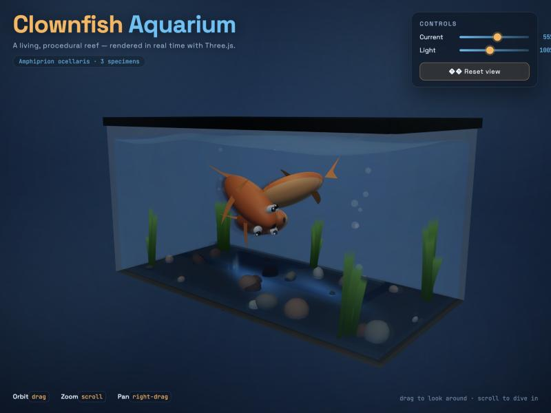

# Qwen3.8-Flash-Next — CMF

[Qwen3.8-Flash-Next](https://huggingface.co/Qwen/Qwen3.8-Flash-Next) — a 125B
hybrid mixture-of-experts model, 6B active per token (36 Gated DeltaNet + 12
sparse-attention layers, 512 experts per layer, 51B n-gram table, 262k context,
thinking mode) — as [CMF](https://github.com/infosave2007/cmf) files, text only.
It runs with `cortiq`, a Rust engine with no Python. Experts stream from the
memory-mapped file as tokens need them, so the default 77 GB file runs on one
GPU (measured from a 12 GB VRAM budget up to a whole 32 GB card) with the rest
in system RAM.

**RTX 3090 (24 GB), cortiq 0.8.15: 49.1 tok/s decode; first token after a
1,000-token prompt in 9.9 s.** RTX 5090 (cortiq 0.8.8): 81.7 tok/s, 108.6 with
speculative decoding.

[English](#quick-start) · [Русский](#документация-на-русском) · [中文](#中文文档)

## Quick start

```bash
cargo install cortiq-cli --locked
hf download infosave/Qwen3.8-Flash-Next-cmf qwen38-flash-next-q2tp.cmf flashnext.profile --local-dir .
CMF_QWEN_PROFILE=flashnext.profile cortiq run qwen38-flash-next-q2tp.cmf --prompt "Explain quicksort in three sentences." --no-think
```

Use cortiq 0.8.15 or later ([prebuilt binaries](https://github.com/infosave2007/cmf/releases)).
Without `--no-think` the model reasons first; raise `--max-tokens` (default
256). Each `cortiq run` loads the model again (10–30 s to the first token); for
chat, keep it loaded with [`cortiq serve`](#openai-compatible-server).

## Files

| file | contents | size | code ppl | use |
|---|---|---:|---:|---|
| `qwen38-flash-next-q2tp.cmf` | experts 2-bit gate/up, 4-bit down | 76.95 GB | 4.763 | **default**, fastest |
| `qwen38-flash-next-q4tp.cmf` | experts 4-bit | 97.12 GB | **4.111** | better quality, about half the speed |
| `qwen38-flash-next-q2tp.mtp.cmf` | multi-token-prediction head | 1.08 GB | | optional: faster on the RTX 5090, slower on the RTX 3090 ([speculative decoding](#speculative-decoding)) |
| `qwen38-flash-next-q4tp.mtp.cmf` | the same for q4tp | 1.50 GB | | optional |
| `flashnext.profile` | routing profile (not weights) | 98 KB | | recommended: warms the expert cache (RTX 5090: 81.7 tok/s with it, 56.5 without) |
| `flashnext-q4tp.profile` | the same for q4tp | 98 KB | | recommended with q4tp |

Quantized from the bf16 checkpoint; attention, embeddings and the output head
are 8-bit. Code ppl: perplexity on 1,536 tokens of Rust source, lower is
better. An `.mtp.cmf` file is used only when it sits next to its model file
under the name shown.

## Performance

Decode, one stream, `cortiq bench --tokens 120 --core` (greedy), q2tp file +
`flashnext.profile`, tok/s:

| GPU | cortiq | full card | 16 GB budget | 12 GB budget | full card, speculative |
|---|---|---:|---:|---:|---:|
| **RTX 3090 (24 GB)** | **0.8.15** | **49.1** | **34.6** | **22.1** | 44.3 (slower, keep off) |
| RTX 5090 (32 GB) | 0.8.8 | 81.7 | 50.5 | 31.4 | 108.6 |
| RTX 4090 (24 GB) | 0.8.7 | 41.9 | 27.2 | 16.3 | 41.4 |
| RTX 5090, `q4tp` file | 0.8.9 | 40.3 | 27.5 | 23.2 | 44.4 |

The 16 GB and 12 GB columns cap the same card with `CMF_GPU_VRAM_MB=16000` /
`12000`. The RTX 3090 host holds the whole file in RAM (medians of 3 runs); the
RTX 5090 and 4090 hosts had 62 GB of RAM, so their small-budget rows include
disk reads. Rows from older versions were not re-measured; 0.8.7 (the RTX 4090
row) runs at about 60 % of the speed of later versions. Bench numbers are a best
case: the profile was recorded on prompts that include the bench prompt.

Long prompts, RTX 3090, cortiq 0.8.15:

| prompt | prompt, tok/s | first token | decode at that depth, tok/s |
|---|---:|---:|---:|
| ~1,000-token text, steady rate | 67.5 | | |
| `cortiq bench --ctx 1000` | 42.0 | 9.9 s | 40.2 |
| `cortiq bench --ctx 2000` | 40.4 | 20.7 s | 38.7 |

Real text, greedy, no thinking, full card, tok/s:

| GPU | text | plain | speculative |
|---|---|---:|---:|
| RTX 3090, 0.8.15 | 200-token story | **31.4** | 23.4 |
| RTX 5090, 0.8.8 | seven 170–180-token answers via `cortiq serve` (story, code, SQL, Russian text) | 47–63 | 54–65 |
| RTX 5090, 0.8.8 | [3D aquarium](examples/3d-aquarium/README.md): 10,930-token working Three.js page | | 67.8 |



## Hardware and memory

Disk: the file size (77 GB `q2tp`, 97 GB `q4tp`). RAM: the file size for full
speed; with less it still runs, slower (table below). GPU: Vulkan, measured on
NVIDIA RTX 3090, 4090 and 5090 (`cortiq gpu` lists adapters, `CMF_GPU_ADAPTER`
picks one). On headless Linux, if `cortiq gpu` lists nothing, install
`libglvnd0 libgl1 libegl1 libvulkan1 vulkan-tools` ([script](https://github.com/infosave2007/cmf/blob/master/tools/runpod_vulkan_setup.sh))
and export `XDG_RUNTIME_DIR=/tmp` for every run; otherwise the engine silently
falls back to the CPU.

The 4.57 GB of weights that every token uses stay on the card; the rest of the
VRAM budget caches the most-used experts, and any other expert is copied in
from RAM or disk when a token needs it:

| your machine | what happens | measured, tok/s |
|---|---|---|
| RAM holds the file | experts not on the card are copied from RAM | RTX 3090 rows above |
| less RAM than the file | experts in neither VRAM nor RAM come from disk; small budgets suffer most | RTX 5090, 62 GB RAM: 81.7 full card, 31.4 at 12 GB; `q4tp` 11–20 on real prompts |
| 16 GB card | default budget about 13.5 GiB | 16,000 MiB cap: 34.6 (3090), 50.5 (5090) |
| 12 GB card | default budget about 9.5 GiB, below the measured range; set `CMF_QWEN_MTP=0` | not measured |
| no usable GPU | `CMF_GPU=0` (CPU build: `cargo install cortiq-cli --locked --no-default-features`) | 3.6 on an AMD EPYC 7702 (cortiq 0.8.5) |

## Usage

```bash
cortiq run qwen38-flash-next-q2tp.cmf                              # interactive chat, thinking on
cortiq run qwen38-flash-next-q2tp.cmf --prompt "..." --no-think    # direct answer
cortiq run qwen38-flash-next-q2tp.cmf --prompt "..." --greedy      # deterministic output
```

Qwen's recommended sampling:

| mode | `--temperature` | `--top-p` | `--top-k` | `--min-p` | `--presence-penalty` | `--rep-penalty` |
|---|---:|---:|---:|---:|---:|---:|
| thinking (default) | 1.0 | 0.95 | 20 | 0.0 | 0.0 | 1.0 |
| `--no-think` | 0.7 | 0.80 | 20 | 0.0 | 1.5 | 1.0 |

Without flags the CLI uses temperature 0.7, repetition penalty 1.1 and at most
256 new tokens; `--greedy` is temperature 0.

### OpenAI-compatible server

```bash
CMF_QWEN_PROFILE=flashnext.profile cortiq serve qwen38-flash-next-q2tp.cmf --host 127.0.0.1 --port 8080

curl http://127.0.0.1:8080/v1/chat/completions -H "Content-Type: application/json" \
  -d '{"model": "qwen38-flash-next-q2tp", "messages": [{"role": "user", "content": "Hi!"}], "enable_thinking": false}'
```

Endpoints: `/v1/chat/completions` (streaming, `tools`, `enable_thinking`),
`/v1/completions`, `/v1/models`, `/healthz`, web dashboard on `/`. Without
`--host` the server listens on all interfaces (`0.0.0.0`).

## Speculative decoding

The `.mtp.cmf` file holds the model's multi-token-prediction head. Under greedy
decoding (`--greedy`, or `temperature: 0` in the API) it drafts 3 tokens per
round (`CMF_QWEN_MTP_K`) and the model checks them in one pass; the text matches
plain greedy output except at floating-point near-ties. It pays on an RTX 5090
at the full card (81.7 → 108.6 tok/s), is level at 16 and 12 GB budgets, and
is slower on an RTX 3090 (49.1 → 44.3), so there leave the file out or set
`CMF_QWEN_MTP=0`. Sampled runs do not speculate, yet the file still takes about
0.9 GB of VRAM whenever it sits next to the model: for sampled chat, set
`CMF_QWEN_MTP=0` too.

## Long context

The model supports 262,144 tokens; the GPU path serves about 16k. Past that the
GPU path turns itself off and the rest of that request is generated without the
earlier context. For longer prompts or conversations, set `CMF_QWEN_DEVICE=0`
(host path, much slower) before the run starts.

## Settings

| variable | default | what it does |
|---|---|---|
| `CMF_GPU_VRAM_MB` | card minus 2.5–4 GiB | VRAM budget cap, MiB |
| `CMF_QWEN_PROFILE` | unset | routing profile to warm the expert cache |
| `CMF_QWEN_PROFILE_SAVE` | unset | record your own profile (written every 32 tokens) |
| `CMF_QWEN_MTP` | on if the `.mtp.cmf` file is present | `0` = no speculative decoding, frees ~0.9 GB VRAM |
| `CMF_QWEN_MTP_K` | 3 | drafts per round, 1–7 (3 is fastest on the RTX 5090) |
| `CMF_QWEN_KV_RESERVE_MB` | 768 | VRAM for K/V caches, covers ~16k; lower it for more cached experts |
| `CMF_QWEN_DEVICE` | on | `0` = host path, for contexts beyond ~16k |
| `CMF_QWEN_HTIER_MB` | off | Linux: `auto` or a size in MiB of pinned RAM from which the card reads missing experts itself; slower start, decode −7 to +5 % on the RTX 3090; meant for a long-running `cortiq serve` |
| `CMF_QWEN_IO` | `mmap` | how experts not in RAM are read: `direct` (O_DIRECT, Linux) or `pread` (buffered); try when RAM is smaller than the file |

## Limits

- Text only: the upstream vision encoder is not included.
- Measured on NVIDIA through Vulkan; AMD, Intel and DX12 are not measured.
- Apple silicon: the Metal backend has no GPU path for this architecture; the
  model runs the much slower host path (not measured).
- One stream measured; concurrent `cortiq serve` requests are not.

## Verify the download

```text
e84cb832124bf4df8b6c9b3e5daa1e8b0caa47187a240f3b45d72173fce9935b  qwen38-flash-next-q2tp.cmf
601474afd6c7144dcfaf8e084cb2d2e786e06b4aeee3f20310ee0cae07224dfd  qwen38-flash-next-q4tp.cmf
a9cc9760d57db47d7365efcb21bdc13bdfc910947f3a547832d1945f0b56350a  qwen38-flash-next-q2tp.mtp.cmf
3a2c2fd90c8cfe309ef236418147a838663f3de0c13637a47428823f032d67f8  qwen38-flash-next-q4tp.mtp.cmf
```

```bash
sha256sum qwen38-flash-next-q2tp.cmf      # compare with the digest above
cortiq verify qwen38-flash-next-q2tp.cmf  # checks every per-tensor hash
```

## License and attribution

Weights derive from the Qwen team's release and remain under the [Qwen Community License 1.0](https://huggingface.co/Qwen/Qwen3.8-Flash-Next/blob/main/LICENSE). The CMF format and the `cortiq` runtime are Apache-2.0: source at [github.com/infosave2007/cmf](https://github.com/infosave2007/cmf), format front page and model index at [infosave/cmf](https://huggingface.co/infosave/cmf), the quantization ladder at [FORMATS.md](https://huggingface.co/infosave/cmf/blob/main/FORMATS.md).

---

## Документация на русском

[Qwen3.8-Flash-Next](https://huggingface.co/Qwen/Qwen3.8-Flash-Next) — гибридная
смесь экспертов на 125 млрд параметров, 6 млрд активных на токен (36 слоёв
Gated DeltaNet + 12 слоёв разреженного внимания, 512 экспертов на слой,
n-gram-таблица 51 млрд, контекст 262k, режим рассуждений), в формате
[CMF](https://github.com/infosave2007/cmf), только текст. Запускается движком
`cortiq` на Rust без Python. Эксперты читаются из отображённого в память файла
по мере надобности, поэтому основной файл на 77 ГБ работает на одной видеокарте
(измерено от бюджета видеопамяти 12 ГБ до целой карты на 32 ГБ), остальное — в ОЗУ.

**RTX 3090 (24 ГБ), cortiq 0.8.15: генерация 49.1 ток/с; первый токен после
промпта из 1000 токенов — через 9.9 с.** RTX 5090 (cortiq 0.8.8): 81.7 ток/с,
108.6 со спекулятивным декодированием.

### Быстрый старт

```bash
cargo install cortiq-cli --locked
hf download infosave/Qwen3.8-Flash-Next-cmf qwen38-flash-next-q2tp.cmf flashnext.profile --local-dir .
CMF_QWEN_PROFILE=flashnext.profile cortiq run qwen38-flash-next-q2tp.cmf --prompt "Объясни квиксорт в трёх предложениях." --no-think
```

Нужен cortiq 0.8.15 или новее ([готовые сборки](https://github.com/infosave2007/cmf/releases)).
Без `--no-think` модель сначала рассуждает; увеличьте `--max-tokens` (по
умолчанию 256). Каждый `cortiq run` заново загружает модель (10–30 с до первого
токена); для чата держите её загруженной через `cortiq serve`.

### Файлы

| файл | содержимое | размер | ppl кода | назначение |
|---|---|---:|---:|---|
| `qwen38-flash-next-q2tp.cmf` | эксперты: gate/up 2 бита, down 4 бита | 76.95 ГБ | 4.763 | **по умолчанию**, самый быстрый |
| `qwen38-flash-next-q4tp.cmf` | эксперты 4 бита | 97.12 ГБ | **4.111** | качественнее, примерно вдвое медленнее |
| `qwen38-flash-next-q2tp.mtp.cmf` | голова многотокенного предсказания | 1.08 ГБ | | необязательно: на RTX 5090 ускоряет, на RTX 3090 замедляет ([спекулятивное декодирование](#спекулятивное-декодирование)) |
| `qwen38-flash-next-q4tp.mtp.cmf` | то же для q4tp | 1.50 ГБ | | необязательно |
| `flashnext.profile` | профиль маршрутизации (не веса) | 98 КБ | | рекомендуется: прогревает кэш экспертов (RTX 5090: 81.7 ток/с с ним, 56.5 без) |
| `flashnext-q4tp.profile` | то же для q4tp | 98 КБ | | рекомендуется с q4tp |

Квантовано из bf16; внимание, эмбеддинги и выходная голова — 8 бит. Ppl кода —
перплексия на 1536 токенах исходного кода на Rust, меньше — лучше. MTP-файл
подхватывается, только если лежит рядом со своей моделью под указанным именем.

### Скорость

Генерация, один поток, `cortiq bench --tokens 120 --core` (жадно), файл q2tp +
`flashnext.profile`, ток/с:

| видеокарта | cortiq | вся карта | бюджет 16 ГБ | бюджет 12 ГБ | вся карта, спекуляция |
|---|---|---:|---:|---:|---:|
| **RTX 3090 (24 ГБ)** | **0.8.15** | **49.1** | **34.6** | **22.1** | 44.3 (медленнее, выключайте) |
| RTX 5090 (32 ГБ) | 0.8.8 | 81.7 | 50.5 | 31.4 | 108.6 |
| RTX 4090 (24 ГБ) | 0.8.7 | 41.9 | 27.2 | 16.3 | 41.4 |
| RTX 5090, файл `q4tp` | 0.8.9 | 40.3 | 27.5 | 23.2 | 44.4 |

Столбцы 16 и 12 ГБ — та же карта с ограничением `CMF_GPU_VRAM_MB=16000` /
`12000`. На машине с RTX 3090 весь файл помещается в ОЗУ (медианы трёх
запусков); у машин с RTX 5090 и 4090 было 62 ГБ ОЗУ, поэтому строки с малым
бюджетом включают чтение с диска. Строки старых версий не перемерялись; 0.8.7
(строка RTX 4090) работает примерно на 60 % скорости более новых версий. Цифры
bench — лучший случай: профиль записан на промптах, среди которых есть промпт
bench.

Длинные промпты, RTX 3090, cortiq 0.8.15:

| промпт | промпт, ток/с | первый токен | генерация на этой глубине, ток/с |
|---|---:|---:|---:|
| текст ~1000 токенов, установившаяся скорость | 67.5 | | |
| `cortiq bench --ctx 1000` | 42.0 | 9.9 с | 40.2 |
| `cortiq bench --ctx 2000` | 40.4 | 20.7 с | 38.7 |

Реальные тексты (жадно, без рассуждений, вся карта): RTX 3090, 0.8.15 — рассказ
на 200 токенов 31.4 ток/с, со спекуляцией 23.4; RTX 5090, 0.8.8 — семь ответов
по 170–180 токенов через `cortiq serve` 47–63, со спекуляцией 54–65;
[3D-аквариум](examples/3d-aquarium/README.md) — рабочая страница на Three.js из
10 930 токенов, 67.8 со спекуляцией.

### Железо и память

Диск: размер файла (77 ГБ `q2tp`, 97 ГБ `q4tp`). ОЗУ: размер файла для полной
скорости; с меньшим объёмом модель тоже работает, но медленнее (таблица ниже).
Видеокарта: Vulkan, измерено на NVIDIA RTX 3090, 4090 и 5090 (`cortiq gpu`
показывает адаптеры, `CMF_GPU_ADAPTER` выбирает нужный). На Linux без дисплея,
если `cortiq gpu` пуст, установите `libglvnd0 libgl1 libegl1 libvulkan1 vulkan-tools`
([скрипт](https://github.com/infosave2007/cmf/blob/master/tools/runpod_vulkan_setup.sh))
и задавайте `XDG_RUNTIME_DIR=/tmp` при каждом запуске, иначе движок молча
уходит на процессор.

4.57 ГБ весов, нужных каждому токену, постоянно лежат на карте; остальной
бюджет видеопамяти занимает кэш самых используемых экспертов, а прочие эксперты
по мере надобности копируются из ОЗУ или читаются с диска:

| ваша машина | что происходит | измерено, ток/с |
|---|---|---|
| ОЗУ вмещает файл | эксперты, которых нет на карте, копируются из ОЗУ | строки RTX 3090 выше |
| ОЗУ меньше файла | эксперты, которых нет ни в видеопамяти, ни в ОЗУ, читаются с диска; сильнее всего при малом бюджете | RTX 5090, 62 ГБ ОЗУ: 81.7 вся карта, 31.4 при 12 ГБ; `q4tp` 11–20 на реальных промптах |
| карта 16 ГБ | бюджет по умолчанию около 13.5 ГиБ | ограничение 16 000 МиБ: 34.6 (3090), 50.5 (5090) |
| карта 12 ГБ | бюджет по умолчанию около 9.5 ГиБ, ниже измеренного диапазона; ставьте `CMF_QWEN_MTP=0` | не измерялось |
| нет подходящей видеокарты | `CMF_GPU=0` (сборка для CPU: `cargo install cortiq-cli --locked --no-default-features`) | 3.6 на AMD EPYC 7702 (cortiq 0.8.5) |

### Использование

```bash
cortiq run qwen38-flash-next-q2tp.cmf                              # интерактивный чат с рассуждениями
cortiq run qwen38-flash-next-q2tp.cmf --prompt "..." --no-think    # прямой ответ
cortiq run qwen38-flash-next-q2tp.cmf --prompt "..." --greedy      # детерминированный вывод
CMF_QWEN_PROFILE=flashnext.profile cortiq serve qwen38-flash-next-q2tp.cmf --host 127.0.0.1 --port 8080   # OpenAI API
```

Сэмплирование, рекомендованное Qwen: с рассуждениями `--temperature 1.0 --top-p 0.95 --top-k 20
--min-p 0.0 --presence-penalty 0.0 --rep-penalty 1.0`; с `--no-think` —
`--temperature 0.7 --top-p 0.80 --top-k 20 --min-p 0.0 --presence-penalty 1.5
--rep-penalty 1.0`. Без флагов: temperature 0.7, repetition penalty 1.1, до 256
новых токенов; `--greedy` — temperature 0. Эндпоинты сервера: `/v1/chat/completions`
(потоковый режим, `tools`, `enable_thinking`), `/v1/completions`, `/v1/models`,
`/healthz`, веб-панель на `/`; без `--host` сервер слушает все интерфейсы
(`0.0.0.0`).

### Спекулятивное декодирование

MTP-файл содержит голову многотокенного предсказания. При жадном выводе
(`--greedy` или `temperature: 0` в API) она предлагает 3 токена за раунд
(`CMF_QWEN_MTP_K`), а модель проверяет их за один проход; текст совпадает с
обычным жадным выводом, кроме почти равновероятных токенов, где может сказаться
погрешность вычислений. Оно выгодно на RTX 5090 на всей карте (81.7 → 108.6
ток/с), при 16 и 12 ГБ выигрыша нет, на RTX 3090 медленнее (49.1 → 44.3) — там
не скачивайте файл или ставьте `CMF_QWEN_MTP=0`. При сэмплировании спекуляции
нет, но файл рядом с моделью всё равно занимает около 0.9 ГБ видеопамяти, поэтому
для чата с сэмплированием тоже ставьте `CMF_QWEN_MTP=0`.

### Длинный контекст

Модель поддерживает 262 144 токена; путь через видеокарту обслуживает около 16
тысяч. Дальше он сам отключается, и остаток этого запроса генерируется без
учёта предыдущего контекста. Для более длинных промптов и диалогов задайте
`CMF_QWEN_DEVICE=0` (хост-путь, намного медленнее) до запуска.

### Настройки

| переменная | по умолчанию | что делает |
|---|---|---|
| `CMF_GPU_VRAM_MB` | карта минус 2.5–4 ГиБ | ограничение бюджета видеопамяти, МиБ |
| `CMF_QWEN_PROFILE` | нет | профиль для прогрева кэша экспертов |
| `CMF_QWEN_PROFILE_SAVE` | нет | записать свой профиль (каждые 32 токена) |
| `CMF_QWEN_MTP` | вкл., если есть MTP-файл | `0` — без спекуляции, освобождает ~0.9 ГБ видеопамяти |
| `CMF_QWEN_MTP_K` | 3 | черновиков за раунд, 1–7 (3 — быстрее всего на RTX 5090) |
| `CMF_QWEN_KV_RESERVE_MB` | 768 | видеопамять под K/V, хватает на ~16k; меньше — больше экспертов в кэше |
| `CMF_QWEN_DEVICE` | вкл. | `0` — хост-путь, для контекста больше ~16k |
| `CMF_QWEN_HTIER_MB` | выкл. | Linux: `auto` или размер в МиБ закреплённой ОЗУ, из которой карта сама забирает недостающих экспертов; старт медленнее, генерация −7…+5 % на RTX 3090; рассчитано на долго работающий `cortiq serve` |
| `CMF_QWEN_IO` | `mmap` | как читаются эксперты вне ОЗУ: `direct` (O_DIRECT, Linux) или `pread` (буферизованно); попробуйте, если ОЗУ меньше файла |

### Ограничения

- Только текст: визуальный энкодер исходной модели не включён.
- Измерено на NVIDIA через Vulkan; AMD, Intel и DX12 не измерялись.
- Apple silicon: у Metal-бэкенда нет пути через видеокарту для этой
  архитектуры, модель работает на намного более медленном хост-пути (не
  измерялось).
- Измерен один поток; параллельные запросы `cortiq serve` — нет.

### Проверка загрузки

Суммы SHA-256 всех четырёх файлов — в разделе [Verify the download](#verify-the-download).

```bash
sha256sum qwen38-flash-next-q2tp.cmf      # сравните с суммой из списка
cortiq verify qwen38-flash-next-q2tp.cmf  # проверяет хеш каждого тензора
```

Веса распространяются на условиях [Qwen Community License 1.0](https://huggingface.co/Qwen/Qwen3.8-Flash-Next/blob/main/LICENSE); формат CMF и движок `cortiq` — Apache-2.0.

---

## 中文文档

[Qwen3.8-Flash-Next](https://huggingface.co/Qwen/Qwen3.8-Flash-Next) 是 1250 亿
参数的混合专家模型，每个 token 激活 60 亿（36 个 Gated DeltaNet 层 + 12 个稀疏
注意力层，每层 512 个专家，510 亿参数的 n-gram 表，262k 上下文，支持思考模式），
此处为 [CMF](https://github.com/infosave2007/cmf) 文件，仅含文本，由不依赖 Python
的 Rust 引擎 `cortiq` 运行。专家从内存映射的文件中按需读取，因此 77 GB 的默认文件可在
一块 GPU 上运行（实测从 12 GB 显存预算到整张 32 GB 显卡），其余部分在系统内存中。

**RTX 3090（24 GB），cortiq 0.8.15：解码 49.1 tok/s；1000 token 提示词后 9.9 秒
出首 token。** RTX 5090（cortiq 0.8.8）：81.7 tok/s，推测解码 108.6。

### 快速开始

```bash
cargo install cortiq-cli --locked
hf download infosave/Qwen3.8-Flash-Next-cmf qwen38-flash-next-q2tp.cmf flashnext.profile --local-dir .
CMF_QWEN_PROFILE=flashnext.profile cortiq run qwen38-flash-next-q2tp.cmf --prompt "用三句话解释快速排序。" --no-think
```

请使用 cortiq 0.8.15 或更新版本（[预编译二进制](https://github.com/infosave2007/cmf/releases)）。
不加 `--no-think` 时模型会先思考，请调高 `--max-tokens`（默认 256）。每次
`cortiq run` 都会重新加载模型（首 token 前 10–30 秒），聊天请用 `cortiq serve` 常驻。

### 文件

| 文件 | 内容 | 大小 | 代码困惑度 | 用途 |
|---|---|---:|---:|---|
| `qwen38-flash-next-q2tp.cmf` | 专家 gate/up 2 位，down 4 位 | 76.95 GB | 4.763 | **默认**，最快 |
| `qwen38-flash-next-q4tp.cmf` | 专家 4 位 | 97.12 GB | **4.111** | 质量更好，速度约减半 |
| `qwen38-flash-next-q2tp.mtp.cmf` | 多 token 预测头 | 1.08 GB | | 可选：RTX 5090 上更快，RTX 3090 上更慢（[推测解码](#推测解码)） |
| `qwen38-flash-next-q4tp.mtp.cmf` | q4tp 的同类文件 | 1.50 GB | | 可选 |
| `flashnext.profile` | 路由画像（非权重） | 98 KB | | 推荐：预热专家缓存（RTX 5090：有 81.7 tok/s，无 56.5） |
| `flashnext-q4tp.profile` | q4tp 的同类文件 | 98 KB | | 搭配 q4tp 推荐 |

由 bf16 权重量化；注意力、嵌入和输出头为 8 位。代码困惑度在 1536 个 token 的 Rust
源码上测得，越低越好。MTP 文件须按上表名称放在对应模型文件旁边才会生效。

### 性能

解码，单流，`cortiq bench --tokens 120 --core`（贪心），q2tp 文件 +
`flashnext.profile`，tok/s：

| GPU | cortiq | 整卡 | 16 GB 预算 | 12 GB 预算 | 整卡，推测解码 |
|---|---|---:|---:|---:|---:|
| **RTX 3090（24 GB）** | **0.8.15** | **49.1** | **34.6** | **22.1** | 44.3（更慢，建议关闭） |
| RTX 5090（32 GB） | 0.8.8 | 81.7 | 50.5 | 31.4 | 108.6 |
| RTX 4090（24 GB） | 0.8.7 | 41.9 | 27.2 | 16.3 | 41.4 |
| RTX 5090，`q4tp` 文件 | 0.8.9 | 40.3 | 27.5 | 23.2 | 44.4 |

16 GB 与 12 GB 两列是在同一张卡上用 `CMF_GPU_VRAM_MB=16000` / `12000` 限制显存。
RTX 3090 主机的内存可容纳整个文件（三次运行取中位数）；RTX 5090 与 4090 主机只有
62 GB 内存，因此小预算的结果包含磁盘读取。旧版本的结果未重测；0.8.7（RTX 4090 行）
的速度约为之后版本的 60%。bench 数字为最佳情况：录制路由画像所用的提示词包含 bench
提示词。

长提示词，RTX 3090，cortiq 0.8.15：

| 提示词 | 提示词 tok/s | 首 token | 该深度解码 tok/s |
|---|---:|---:|---:|
| 约 1000 token 文本，稳定速率 | 67.5 | | |
| `cortiq bench --ctx 1000` | 42.0 | 9.9 s | 40.2 |
| `cortiq bench --ctx 2000` | 40.4 | 20.7 s | 38.7 |

真实文本（贪心，不思考，整卡）：RTX 3090（0.8.15）200 token 故事 31.4 tok/s，
推测解码 23.4；RTX 5090（0.8.8）经 `cortiq serve` 的七个 170–180 token 回答
47–63，推测解码 54–65；[3D 水族箱](examples/3d-aquarium/README.md)：10 930 token
的可运行 Three.js 页面，推测解码 67.8。

### 硬件与内存

磁盘：文件大小（`q2tp` 77 GB，`q4tp` 97 GB）。内存：全速运行需不少于文件大小；
内存更少也能运行，但更慢（见下表）。GPU：Vulkan，已在 NVIDIA RTX 3090、4090、5090
上实测（`cortiq gpu` 列出适配器，`CMF_GPU_ADAPTER` 指定使用哪一个）。无显示器的
Linux 上若 `cortiq gpu` 为空，安装 `libglvnd0 libgl1 libegl1 libvulkan1 vulkan-tools`
（[脚本](https://github.com/infosave2007/cmf/blob/master/tools/runpod_vulkan_setup.sh)），
并在每次运行时设置 `XDG_RUNTIME_DIR=/tmp`，否则引擎会静默回退到 CPU。

每个 token 都用到的 4.57 GB 权重常驻显卡；其余显存预算缓存最常用的专家，其他专家
在需要时从内存复制或从磁盘读取：

| 你的机器 | 表现 | 实测 tok/s |
|---|---|---|
| 内存可容纳文件 | 不在显卡上的专家从内存复制 | 上表 RTX 3090 各行 |
| 内存小于文件 | 显存和内存都没有的专家从磁盘读取，小预算受影响最大 | RTX 5090，62 GB 内存：整卡 81.7，12 GB 时 31.4；`q4tp` 真实提示词 11–20 |
| 16 GB 显卡 | 默认预算约 13.5 GiB | 16 000 MiB 限额：34.6（3090），50.5（5090） |
| 12 GB 显卡 | 默认预算约 9.5 GiB，低于实测范围；请设 `CMF_QWEN_MTP=0` | 未测 |
| 无可用 GPU | `CMF_GPU=0`（CPU 版：`cargo install cortiq-cli --locked --no-default-features`） | 3.6（AMD EPYC 7702，cortiq 0.8.5） |

### 使用

```bash
cortiq run qwen38-flash-next-q2tp.cmf --prompt "..." --no-think    # 直接回答
CMF_QWEN_PROFILE=flashnext.profile cortiq serve qwen38-flash-next-q2tp.cmf --host 127.0.0.1 --port 8080   # OpenAI 兼容 API
```

Qwen 推荐的采样参数：思考模式 temperature 1.0、top-p 0.95、top-k 20、min-p 0、
presence penalty 0；`--no-think` 模式 temperature 0.7、top-p 0.80、top-k 20、
min-p 0、presence penalty 1.5；repetition penalty 均为 1.0。不加参数时 CLI 使用
temperature 0.7、repetition penalty 1.1，最多生成 256 个新 token；`--greedy` 即
temperature 0。服务器端点：`/v1/chat/completions`（流式、`tools`、
`enable_thinking`）、`/v1/completions`、`/v1/models`、`/healthz`，以及 `/` 上的
网页面板；不加 `--host` 时监听所有网络接口（`0.0.0.0`）。

### 推测解码

MTP 文件包含模型的多 token 预测头。贪心解码时（`--greedy` 或 API 中
`temperature: 0`）每轮起草 3 个 token（`CMF_QWEN_MTP_K`），主模型一次前向完成验证；
除浮点误差造成的近似平局外，输出与普通贪心解码一致。RTX 5090 整卡上有收益（81.7 →
108.6 tok/s），16 与 12 GB 预算下持平，RTX 3090 上更慢（49.1 → 44.3），此时不要
下载该文件，或设 `CMF_QWEN_MTP=0`。采样运行不做推测，但只要该文件在模型旁边就会
占用约 0.9 GB 显存，因此采样聊天也请设 `CMF_QWEN_MTP=0`。

### 长上下文

模型支持 262 144 个 token；GPU 路径约支持 16k。超出后 GPU 路径自动关闭，该请求的
剩余部分将在不含先前上下文的情况下生成。更长的提示词或对话请在启动前设置
`CMF_QWEN_DEVICE=0`（主机路径，慢得多）。

### 设置

| 变量 | 默认 | 作用 |
|---|---|---|
| `CMF_GPU_VRAM_MB` | 显存减 2.5–4 GiB | 显存预算上限，MiB |
| `CMF_QWEN_PROFILE` | 未设置 | 预热专家缓存的路由画像 |
| `CMF_QWEN_PROFILE_SAVE` | 未设置 | 记录自己的画像（每 32 token 写入） |
| `CMF_QWEN_MTP` | 有 MTP 文件时开启 | `0` = 关闭推测解码，释放约 0.9 GB 显存 |
| `CMF_QWEN_MTP_K` | 3 | 每轮草稿数，1–7（RTX 5090 上 3 最快） |
| `CMF_QWEN_KV_RESERVE_MB` | 768 | K/V 缓存显存，足够 ~16k；调低可多缓存专家 |
| `CMF_QWEN_DEVICE` | 开启 | `0` = 主机路径，用于超过 ~16k 的上下文 |
| `CMF_QWEN_HTIER_MB` | 关闭 | Linux：`auto` 或以 MiB 指定的锁页内存大小，显卡直接从中读取缺失专家；启动变慢，RTX 3090 上解码 −7%…+5%；适合长期运行的 `cortiq serve` |
| `CMF_QWEN_IO` | `mmap` | 不在内存中的专家的读取方式：`direct`（O_DIRECT，Linux）或 `pread`（缓冲读）；内存小于文件时可尝试 |

### 限制

- 仅文本：未包含上游模型的视觉编码器。
- 仅在 NVIDIA（Vulkan）上实测；AMD、Intel 与 DX12 未测。
- Apple silicon：Metal 后端没有该架构的 GPU 路径，模型走慢得多的主机路径（未测）。
- 只测了单流；`cortiq serve` 并发请求未测。

### 校验下载

四个文件的 SHA-256 摘要见 [Verify the download](#verify-the-download) 一节。

```bash
sha256sum qwen38-flash-next-q2tp.cmf      # 与摘要列表比对
cortiq verify qwen38-flash-next-q2tp.cmf  # 校验每个张量的哈希
```

权重遵循 [Qwen Community License 1.0](https://huggingface.co/Qwen/Qwen3.8-Flash-Next/blob/main/LICENSE)；CMF 格式与 `cortiq` 运行时为 Apache-2.0。
