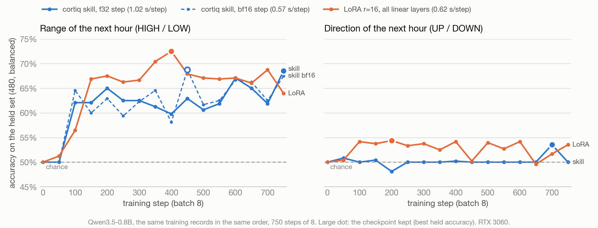
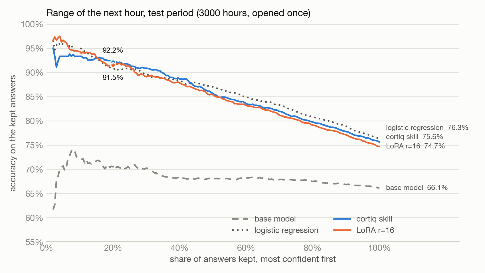

# Market skill: next-hour direction and range (BTCUSDT, EURUSD, USDJPY)

A `cortiq skill bake` experiment on Qwen3.5-0.8B (q8_2f) with the fixed bake (`--through-attn`, soft mask), run on an
RTX 3060 with CUDA. It repeats the protocol of `examples/btc_market_skill` and of the article draft
`docs/HABR_QWEN_BTC_SKILL.ru.md`, whose 47.75 % → 47.25 % had been baked with the mask gradient skipping the frozen
attention and a hard τ = 0.5 cut. It also adds two FX pairs and a second target. This measures classification accuracy
only. It is not a trading strategy.

- Data: 1h bars from 2024-02-07 to 2026-11-24 (Binance BTCUSDT, Yahoo EURUSD=X and USDJPY=X).
- Features and prompt: the article's causal features of 48 closed bars; FX prompts have no volume fields.
- Splits: per market, chronological 70/15/15 with a 49 h purge; the next bar must be exactly +1 h.
- Targets:
  - `dir`: UP if `close[t+1] > close[t]`, else DOWN (the article's target).
  - `range`: HIGH if the next bar's high-low range is above the market's median over its own train split, else LOW.
- Training: one skill per target on all three markets (4000 balanced records each).
- Checkpoint: chosen by validation accuracy inside the bake.
- Evaluation: through `serve` with the skill overlaid (`skill export`, `skill apply --overlay`, `serve --skill`),
  `class_tokens`, thinking off.
- Test period: 2026-06-24 to 2026-11-23, 1000 evenly spaced hours a market, opened once after both skills were frozen.

`PROTOCOL.json` was frozen before any prediction. `JOURNAL.ru.md` is the run log.

## Test period (3000 hours)

| target | base: acc / balanced | skill: acc / balanced | skill − base, acc (95 % CI, paired block bootstrap) | skill, 20 % most confident |
|---|---:|---:|---:|---:|
| `dir` | 51.2 / 50.0 | 50.8 / 50.8 | −0.4 (−2.7, +1.9) | 53.5 |
| `range` | 66.1 / 50.0 | 75.6 / 70.7 | +9.5 (+7.4, +11.7) | 92.2 |

`range` by market (balanced accuracy), with the classical baselines on the same hours:

| market | base | skill | persistence (current range) | logistic regression (features + hour) |
|---|---:|---:|---:|---:|
| BTCUSDT | 50.0 | 70.3 | 71.5 | 69.4 |
| EURUSD | 50.0 | 69.8 | 67.0 | 72.8 |
| USDJPY | 50.0 | 71.6 | 71.5 | 72.3 |

- **Direction.** Next-hour direction stays at a coin flip. So does every honest baseline (majority, momentum,
  reversal, logistic regression: 46–54 %). Fixing the bake did not create a signal that is not in the data.
- **Range.** The skill learns next-hour volatility from the prompt text — the base answers LOW every time. It reaches the
  level of a logistic regression on the same features, not beyond it.
- **Class mix.** The later period is calmer: 63–72 % of test hours are LOW against 50 % in train. Read the balanced
  accuracy.

## The skill file, and LoRA on the same budget

`skill export --gains-from` stores a soft-folded skill as one f32 gain per FFN neuron of each changed
`down_proj`; `skill apply` rebuilds the tensors from the base byte for byte. A LoRA was trained against it on
the same card with the same budget (`lora_bench.py`): the same balanced records in the same order, 750 steps
of 8, the same exact-classifier loss (cross-entropy over the two class tokens at the answer position), the
checkpoint with the best accuracy on the same 480 held records, the test set once. PEFT, rank 16 on every
linear layer of the language model, bf16 weights, adapter in f32, AdamW lr 2e-4 (torch 2.15, the
flash-linear-attention kernels for GDN).

| | cortiq skill (gains) | LoRA r=16 |
|---|---:|---:|
| file | 0.378 MB | 43.3 MB |
| trained parameters | 86 016 gains | 10 822 656 |
| `range` test: acc / balanced / 20 % most confident | 75.6 / 70.7 / 92.2 | 74.7 / 71.3 / 91.5 |
| `dir` test: acc / balanced | 50.8 / 50.8 | 51.0 / 50.5 |
| training, 750 steps, RTX 3060 (fwd + bwd + update) | 765 s (1.02 s/step); 428 s (0.57 s/step) with `CMF_BAKE_RES_BF16=1` | 461 s (0.62 s/step) |

A logistic regression on the prompt's features reaches 76.3 / 71.7 / 90.8 on `range`: neither adapter beats
the classical model, and neither finds a direction signal.

The bake's default step is strict f32 (no tensor cores); `CMF_BAKE_RES_BF16=1` puts its weight products on bf16
operands, as LoRA's autocast does. The `range` bake with it reached 68.75 % on the held records (68.54 % in f32)
in 622 s instead of 1043 s. The published skills and the test numbers above are the f32 ones.





## Reproduce

```sh
python3 market_skill.py fetch-binance BTCUSDT "2024-02-07 00:00" "2026-11-24 00:00" data/BTCUSDT_1h.csv
python3 market_skill.py fetch-yahoo EURUSD=X data/EURUSD_1h.csv
python3 market_skill.py fetch-yahoo USDJPY=X data/USDJPY_1h.csv
python3 market_skill.py prepare data/prep data/BTCUSDT_1h.csv:BTCUSDT data/EURUSD_1h.csv:EURUSD data/USDJPY_1h.csv:USDJPY
./bake.sh dir dir1 && ./bake.sh range range1      # 17 min each on an RTX 3060 (CMF_GPU=cuda)
./run_eval.sh                                       # overlays, held-set parity, validation and test
python3 show_report.py results test
python3 lora_bench.py ~/models/qwen35-08b data/prep range lora_range   # torch, transformers, peft, fla
python3 logit_probs.py data/prep range test results/logit_range_test.jsonl
python3 compare.py DATA && python3 make_charts.py DATA figures         # DATA: the predictions, bake logs, LoRA runs
```

Yahoo's 1h history reaches back 730 days, so a later fetch covers a later period. The scripts use the standard
library only. `bake.sh` and the `run_*` scripts expect the q8_2f base at `~/skill-ode/cmf/qwen35-0.8b-q8_2f.cmf` and
the CLI at `~/cmf-skillode/target/release/cortiq`.
